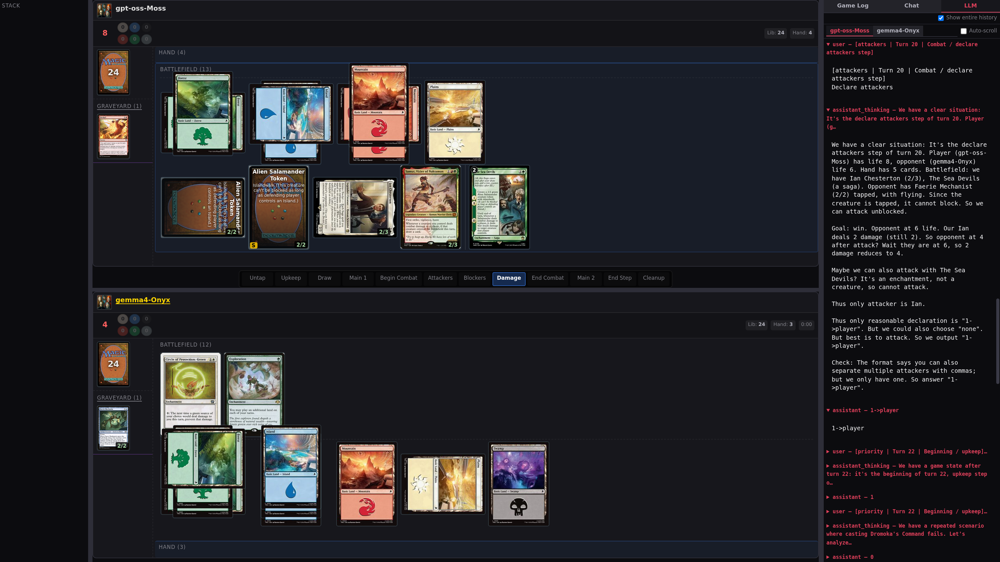
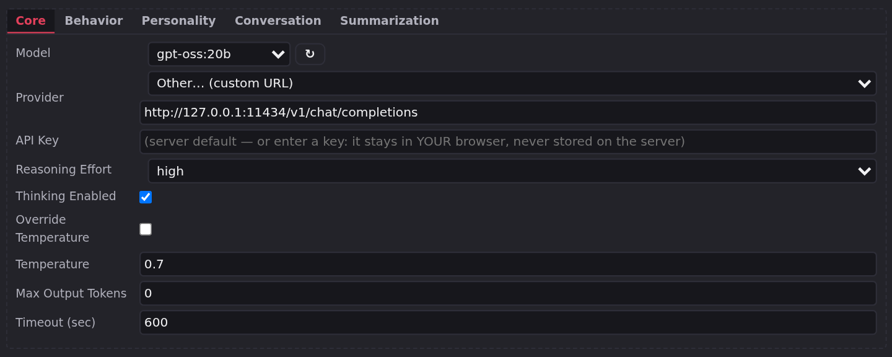

# LLMage — LLM opponents for XMage

LLMage ([llmage.cc](https://llmage.cc)) is a fork of [XMage](https://github.com/magefree/mage),
the Java Magic: The Gathering rules engine. Its AI seats are played by large language models:
instead of scripted heuristics, the bot reads the game state and decides what to do through any
OpenAI-compatible chat-completions endpoint.

The rules engine, card database, and network protocol are XMage's. LLMage adds the LLM player,
a browser client, and the glue that lets both share a table. The standard XMage desktop client
is included and works with the same server.



## Why LLMage

- **LLM decisions, not scripts.** Card choices, targets, mulligans, sideboarding, and yes/no
  prompts go to the model. Deterministic code still handles rules enforcement and low-level
  mechanics such as mana payment.
- **Any OpenAI-compatible endpoint.** Run a local Ollama model, use Ollama Cloud, or point at a
  hosted API. The two LLM seats can use different models and endpoints.
- **Per-seat control.** Model, reasoning effort or thinking budget, personality, context
  window, and chat behaviour are configurable per seat.
- **Browser and desktop.** The React web client covers the lobby, deck editor, full gameplay,
  spectators, tournaments, replays, and the LLM conversation panel. The desktop client remains
  available for the complete upstream XMage feature set.
- **Full XMage underneath.** Formats, card data, tournaments, and replay come from the upstream
  project. LLMage changes the player, not the rules.
- **Watch and review.** Run LLM-vs-LLM games, follow both conversations live, and replay a saved
  game with the per-seat LLM transcript.

## Quick start

You need a Java 21 JDK, Maven 3.9+, Git, and an OpenAI-compatible chat-completions endpoint.
A local Ollama install is enough to start; a cloud provider works without Ollama.

**1. Build the server.**

```bash
export MAVEN_OPTS=-Xmx9g          # the full reactor needs a raised heap
mvn clean install -DskipTests
(cd Mage.Server && mvn package assembly:single -DskipTests)
scripts/deploy-release.sh
```

**2. Point one LLM seat at an endpoint.**

```bash
export LLM1_ENDPOINT="http://localhost:11434/v1/chat/completions"
export LLM1_MODEL="<model-name>"
# For a cloud provider, also export LLM1_KEY="<api-key>".
```

**3. Start the server.**

```bash
scripts/start-server.sh
```

**4. Connect and start a game.**

```bash
scripts/start-client.sh          # desktop client; connect to 127.0.0.1:17171
```

In the Game room, type `\botgame` for LLM vs computer AI, or `\botgame --llm2` for LLM vs LLM.

### Browser client

The web client is a separate build:

```bash
mvn -pl Mage.WebProxy install -DskipTests -Pllmage
(cd Mage.WebProxy/web/frontend/react && npm ci && npm run build)
scripts/start-proxy.sh           # open http://127.0.0.1:8090
```

See [Getting started](docs/getting-started/overview.md) for the full install guide, platform
notes, and the first-game walkthrough.

## What you can do

| Goal | How |
|---|---|
| Play against one LLM | New Table → player type `Computer - LLM`, or `\botgame` |
| Watch two LLMs play | `\botgame --llm2` |
| Play a best-of-three | `\botgame --llm2 --bo3` |
| Put LLM seats in a tournament | New Tournament, select the LLM player type per seat |
| Play in a browser | Start the proxy, open `http://127.0.0.1:8090` |
| Review a game | Replay browser, or the transcripts under the game log directory |



## Documentation

| Section | What it covers |
|---|---|
| [Getting started](docs/getting-started/overview.md) | Install, build, first LLM game |
| [Player guide](docs/player-guide/desktop-client.md) | Desktop and web clients, controls, modes, LLM opponents, replay |
| [Operator guide](docs/operator-guide/server-configuration.md) | Server configuration, deployment, LLM providers, operations, security |
| [Developer guide](docs/developer-guide/architecture.md) | Architecture, build, extension points, testing, wire compatibility |
| [Reference](docs/reference/commands.md) | Commands, file layout, shortcuts, troubleshooting, FAQ, glossary |

## Requirements

- Java 21 JDK and Maven 3.9+ to build.
- An OpenAI-compatible chat-completions endpoint and a model name.
- A desktop environment for the desktop client, or a modern browser for the web client.
- The full Maven reactor needs `MAVEN_OPTS=-Xmx9g`.

The repository ships source only; there is no prebuilt server or client archive.

## Contributing

Read [AGENTS.md](AGENTS.md) for the build, test, and coding conventions, and
[docs/developer-guide/contributing.md](docs/developer-guide/contributing.md) for the public
workflow. Run the relevant tests before opening a pull request; the LLM tests live in
`Mage.Tests`.

## Technical summary of changes

LLMage is a source fork of XMage 1.4.62. The delta falls into six areas; the file-level map is
in [What changed from upstream XMage](docs/developer-guide/fork-changes.md).

### LLM player (new module)

`Mage.Server.Plugins/Mage.Player.LLM` adds `LLMPlayer`, which extends `ComputerPlayer` and
overrides the decision methods that matter: priority, mulligan, sideboard, card and player
targets, choices, piles, modes, trigger order, replacement effects, amounts, X values,
attackers and blockers, and which side of a modal card to cast. `LLMClient` talks to
OpenAI-compatible endpoints, `LLMGameSerializer` renders the game state and decklists into
prompts, `LLMConfig` holds the model, endpoint, thinking, memory, summarization, concession,
and personality settings, and `LLMResponse` carries the thinking and answer text.

### Core engine

- `PlayerType.COMPUTER_LLM` makes the seat type visible in `ServerState`.
- `LLMPlayerConfig` and `Seat.llmPlayerConfig` carry per-seat overrides from a client to the
  server; `MatchOptions.llmPlayerConfigs` carries all seats at once.
- `Personality` is a 35-name registry with a character sketch and playstyle note.
- `GameState.gameLog` and `LLMGameLogCollector` record game events for prompts without editing
  the upstream `informPlayers` hot path.
- `Player.isStreaming()` and the 500 ms streaming poller keep the board live while a model thinks.
- `GameView.llmDebug`, `replayStateIndex`, and replay-session seeking support the web LLM tab and
  replay scrubber.
- `LLMBridgeRegistry` routes browser-held provider keys; `Deck.createCard` accepts a card name
  when the set code or collector number is missing.

### Server

`BotGameHandler` implements the `\botgame` chat command. `LLMClientTransport` routes
browser-key prompts to the browser that owns the table. `GameController` forces state updates
while a player is streaming. `GameSessionPlayer` and `GameSessionWatcher` forward conversations
to the desktop and web debug views. `TableController` auto-watches bot games and applies
per-seat configs. `PlayerFactory` passes the seat config before the plugin constructs, so
context-window detection and the thinking probe use the seat's endpoint. `config.xml` gains the
`llm*` and `llm2*` attributes.

### Desktop client

The Swing client keeps upstream behaviour and adds a tabbed `LLMConfigDialog` (Core, Behavior,
Personality, Conversation, Summarization), per-seat LLM config buttons, and a real-time
`LLMDebugDialog` opened from the toolbar or the `/llm` local command.

### Web proxy and browser client

`Mage.WebProxy` is a new module: a Jetty 12 WebSocket proxy plus a React 19/Vite frontend. The
frontend covers the lobby, table creation, deck editing, the board and prompt types, chat, an
LLM tab, settings, spectating, and a replay viewer with a scrubber and LLM sidecar. The proxy
translates browser messages into server session calls, serves the static bundle, exposes
`GET /config`, and gates LLM and replay features by probing the connected server's capabilities.
Build flavours (`-Pllmage`, `-Pstock`, and the default minimal profile) produce both the LLM
build and an LLM-free artifact for stock servers from one tree.

### Scripts, tests, and fixes

The fork adds deploy, bootstrap, launcher, monitoring, and replay-maintenance scripts; LLM and
proxy test suites; live verification harnesses; and serialization UID gates that fail when a
saved game would be orphaned. Notable correctness fixes include Chrome Mox imprint, any-target
spells, Ponder-style ordering, the land-drop loop, large library and graveyard searches,
priority retry, face-down and stack rendering, and off-thread post-game reflection.

### What did not change

Card rules, card implementations, format definitions, tournament structures, the deck validator,
and the base desktop client behaviour are upstream. A table with only human and stock AI seats
behaves like XMage; the LLM plugin is unused.

## License and attribution

LLMage is based on [XMage](https://github.com/magefree/mage) and is licensed under the MIT
License (see [LICENSE.txt](LICENSE.txt), © 2010 BetaSteward and XMage contributors), with the
third-party exceptions and attributions listed in [THIRD-PARTY-NOTICES.md](THIRD-PARTY-NOTICES.md)
— including card icons (Font Awesome, Bootstrap Icons, Pixabay), Scryfall card data, and a
GPL-licensed upstream component.

Magic: The Gathering is a trademark of Wizards of the Coast LLC. This project is not affiliated
with, sponsored, or endorsed by Wizards of the Coast or Scryfall. Card data and images are
fetched at runtime from public sources for personal, non-commercial use.
