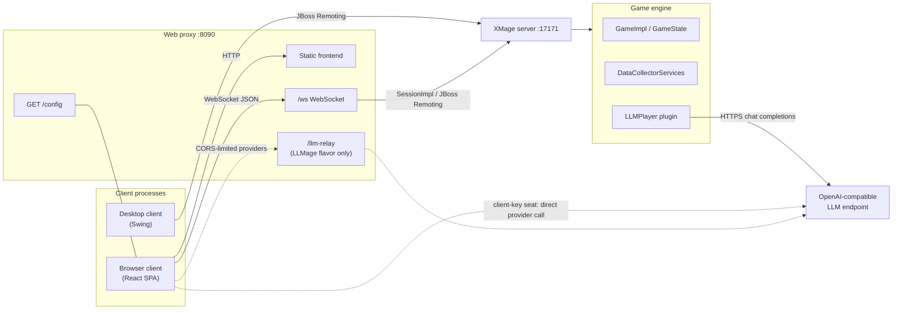
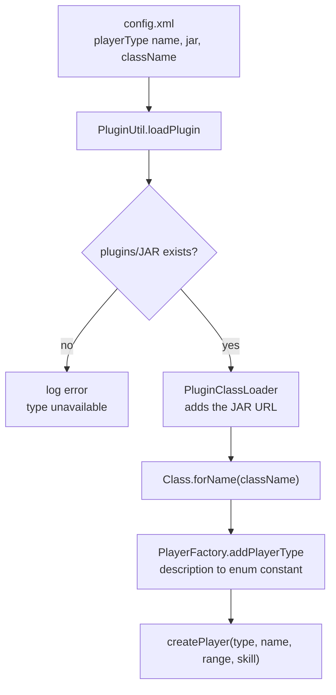
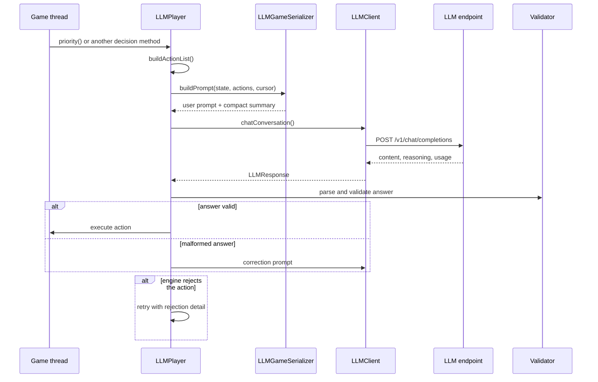
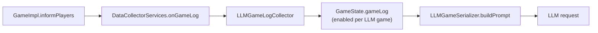

# Architecture

This page describes how LLMage fits together: the modules, the path a request takes from a client to the game engine, how server plugins are loaded, how the LLM player turns a game state into a decision, and where the fork separates itself from stock XMage.

> **Who this is for:** developers who need to locate a component, trace a call, or decide where a new feature belongs.
>
> **LLMage addition.** The LLM player, web proxy, build flavors, and the Core patches are fork additions.

## System at a glance

An LLMage installation runs up to three JVMs. The XMage server owns the authoritative game. The optional web proxy is a separate process that serves the browser client and bridges its WebSocket traffic to the server. The desktop client connects directly to the server. The LLM endpoint is external, reached over HTTP by the server-side LLM player, or by the browser when a seat uses a browser-held key.

| Process or artifact | Role | Default port |
|---|---|---|
| `Mage.Server` | Lobby, tables, matches, tournaments, replay service, plugin host | 17171 |
| `Mage.WebProxy` | Serves the React client; one `SessionImpl` per browser socket | 8090 |
| `Mage.Client` | Swing desktop client; connects to the server directly | none |
| LLM plugin | Server-side player plugin JAR | none |
| LLM endpoint | OpenAI-compatible chat API | provider-defined |

The desktop client and the web proxy both speak to the server through `mage.remote.SessionImpl` in `Mage.Common`. The transport is JBoss Remoting over a bisocket connection, and the payloads are Java-serialized objects. The browser exchanges JSON with the proxy over a WebSocket; the proxy translates.

## Modules

| Module | Responsibility |
|---|---|
| `Mage` | Game rules, card and ability APIs, `GameImpl`, `GameState`, player base classes, `PlayerType`, `Personality`, `LLMPlayerConfig`, data collectors |
| `Mage.Common` | Remote interfaces, `SessionImpl`, client callbacks, shared view objects (`GameView`, `MatchView`, `Seat`), `MageVersion`, the client-key bridge registry |
| `Mage.Server` | Server bootstrap, configuration, lobby/table/game/tournament managers, RPC implementation, replay service, plugin loader |
| `Mage.Sets` | Card implementations |
| `Mage.Client` | Swing desktop client, including the LLM configuration and debug dialogs |
| `Mage.WebProxy` | Jetty 12 proxy and the React frontend build output |
| `Mage.Server.Plugins` | Player, game-type, tournament, and deck plugins, including `Mage.Player.LLM` |
| `Mage.Plugins` | Client-side plugin API and the counter plugin example |
| `Mage.Server.Console` | Console UI and the headless `BotGameRunner` used for LLM-vs-LLM games |
| `Mage.Tests` | JUnit test suites, including the LLM decision tests |
| `Mage.Verify` | Card-data verification suite |
| `Mage.Reports` | Coverage aggregation |

`Mage` does not depend on the server or the proxy; `Mage.Common` depends on `Mage`; `Mage.Server` depends on both. The LLM player is a plugin loaded at runtime, not linked.

## The server and a game

`Mage.Server` accepts a connection, authenticates the user, and exposes lobby and table operations through `MageServerImpl`. A table creates a `Match`; the match creates a `Game`; the game runs on its own thread. Every decision is requested from that thread, one at a time, so a slow player stalls its game rather than the server.

Server-to-client traffic uses callbacks: `Session.fireCallback` delivers a `ClientCallback` with a method constant and a payload. The desktop client and `WebProxyClient` both implement `MageClient` and receive the same shapes, so a shared view change reaches both clients without a second server path.

Replay is a separate service. The server stores game states in a compressed save, and `ReplaySession` walks or seeks through them. The web scrubber uses `Replays.seekTo`, a fork addition; the desktop client keeps its existing controls.

## Plugin loading

Player types, game types, tournament types, and deck validators are configured in `Mage.Server/config/config.xml`. Each entry names a JAR and a class. At boot the server resolves the JAR relative to the `plugins/` directory in the working directory, adds it to a dedicated class loader, and instantiates the class by reflection.

A player plugin has three contracts:

1. The `name` in `config.xml` must match an existing `PlayerType` description exactly; `PlayerType.getByDescription` throws on an unknown name.
2. The class must have a public `(String name, RangeOfInfluence range, int skill)` constructor.
3. The JAR must be under `plugins/`. `scripts/bootstrap-plugins.sh` materializes those entries as symlinks from the release tree and fails on a dangling link.

The LLM player uses this path like any other AI seat. `PlayerFactory` does not special-case it: the server sees `Computer - LLM`, creates the plugin class, and hands it the game.

## The LLM player

`LLMPlayer` is a server-side plugin in `Mage.Server.Plugins/Mage.Player.LLM/`. It extends `ComputerPlayer`, which extends `PlayerImpl`, so the engine can drive it through the normal `Player` interface. It is not a client and it does not need a browser unless the seat uses a browser-held key.

Each seat owns an `LLMConfig` and an `LLMClient`. The config starts from its defaults and the `xmage.llm*` system properties passed by the launcher, then applies a per-seat `LLMPlayerConfig` sent by the desktop or web client. Per-seat values only overwrite non-null fields, so leaving a field at "server default" inherits the launcher configuration.

### Decision pipeline

The priority loop:

1. `buildActionList` asks the engine what the player can do. Index `0` is always "pass priority". Playable lands, spells, and abilities follow. Skip controls and an optional concede entry are appended.
2. `LLMGameSerializer.buildPrompt` renders the new game events since the last decision, the current board, mana sources, the player's own action history, and the numbered action list. If the board hash is unchanged, the full board section is replaced by a short marker; the stack is always rendered because it changes between priority windows.
3. `LLMClient.chatConversation` posts the full prompt; on a non-empty answer it stores the compact summary and the answer in history. Non-streaming responses are parsed from JSON; streaming responses are accumulated and printed without interleaving concurrent seats.
4. The answer passes a validator. A malformed answer triggers a correction prompt with the valid range or format. A valid answer is parsed into an action index and an optional mana plan.
5. `executeAction` calls the engine. If the engine rejects the action, the loop retries up to three times. The final attempt carries the concrete rejection reason and a "do not repeat" constraint. If the model still chooses a rejected action, the player logs a fatal error and passes priority, which keeps the match alive instead of killing it.
6. Provider failures are handled inside `LLMClient`/`LLMPlayer`: five attempts for 429, 5xx, I/O errors, and empty answers, honoring `Retry-After` and otherwise backing off from 2 to 32 seconds. Other 4xx responses fail immediately. Empty-answer retries descend the configured reasoning-effort ladder; the last rung disables thinking so the answer gets the whole output budget. A terminal failure concedes with a recorded result rather than leaving the game hanging.

Every decision type uses this shape with a prompt and validator: mulligan, card and target choice, pile, mode, trigger order, replacement effect, amount, X, attackers, blockers, and sideboard. Unoverridden methods fall back to `ComputerPlayer`.

### Conversation and summarization

The conversation is a rolling transcript. Each exchange stores a compact summary as the user message and the answer plus reasoning as the assistant message. Full board renders are not replayed; the current prompt carries the current state.

When the history crosses a configured fraction of the model's context window, `LLMClient` condenses the older exchanges into a narrative and keeps the most recent ones verbatim. The window is detected at startup from Ollama's `/api/show` or an OpenAI-compatible `/v1/models`, with a manual override when detection is impossible.

Two probes run before the first decision: context-window detection sets the summary budget, and a minimal thinking request validates the configured dialect and effort. An endpoint that rejects those parameters fails at seat creation, not at turn 30.

### Game state and data collectors

The engine already reports every game event through `DataCollectorServices.onGameLog`. The fork adds `LLMGameLogCollector`, which forwards each event into `GameState.gameLog` when logging is enabled. `GameImpl.informPlayers` stays byte-for-byte upstream; the collector is the only writer.

`gameLogEnabled` defaults to false, so non-LLM games pay nothing. `LLMPlayer.useDeck` enables it for the game. The prompt keeps a cursor into the log and reads only new entries; a rollback truncates the log and bumps a truncation epoch, and the cursor is re-derived against that epoch so re-played events are shown again. A board hash provides a second cursor for the board section. The player's own action history is kept separately in `selfLog`, capped at 1,000 entries.

## The web proxy

`WebProxyServer` is a Jetty 12 server with four surfaces:

| Surface | Purpose |
|---|---|
| `/` | Static files from `web/frontend/`, with cache policy |
| `/ws` | WebSocket upgrade; one `WebProxySession` per connection |
| `/config` | Deployment flags read by the connect form: `hideServerTarget`, `llmage` |
| `/llm-relay` | Same-origin byte relay for browser-key provider calls; present only in the LLMage flavor |

A `WebProxySession` creates a `WebProxyClient` and a `SessionImpl`, connects to the server, and translates browser JSON into `SessionImpl` calls. Seventy message types cover lobby, tables, decks, game actions, replay, card search, and LLM seats; callbacks travel the other way.

The proxy is where deployment policy lives: origin allow-listing for the WebSocket upgrade, a per-host connection cap, anonymous-name and table-ownership checks, a start-game join gate, and the model-endpoint allow-list used by model fetching, seat configuration, and `/llm-relay`. These checks run before the server call.

For browser-key seats the server holds no key. `LLMBridgeRegistry` blocks on a request; `LLMClientTransport` routes the prompt to the table owner's browser through a `LLM_PROMPT` callback; the browser calls the provider and returns the answer through `SessionImpl.llmDecision`, completing the future. A route pin keeps the post-game reflection reachable after teardown.

## Build seams

The web proxy is one tree with three flavors:

| Flavor | Jar source root | Manifest | Frontend | `/llm-relay` |
|---|---|---|---|---|
| `-Pllmage` | `src/llmage/java` | `LLMage-Build: true` | `VITE_LLMAGE` unset or true | Registered |
| `-Pstock` | `src/stock/java` | `LLMage-Build: false` | `VITE_LLMAGE=false` | Absent |
| none (minimal) | `src/minimal/java` | no marker | default | Absent |

`WebProxyServer` references the route only through `LLmageRoutes.relayHandler()`. The LLMage source root supplies an implementation that registers the relay; the stock and minimal roots supply a stub that returns null. The stock frontend build replaces `__LLMAGE__` with `false`, so the LLM UI branches are dead code and are removed by the minifier. Runtime behavior is still gated per server by the capability probe, which is why an LLMage proxy can connect to a stock server without offering LLM controls.

The deploy script requires the positive `LLMage-Build: true` marker, so a minimal test jar cannot be shipped as a release artifact by accident.

## Core patches

The fork keeps changes to inherited modules small and additive. The main groups are:

- **Shared types and views:** `PlayerType.COMPUTER_LLM`, `LLMPlayerConfig`, `Personality`, `Seat.llmPlayerConfig`, `MatchOptions.llmPlayerConfigs` and `llmChatPublic`, `GameView.llmDebug` and `replayStateIndex`, `MatchView.playerList`, and `LLMConversationView`.
- **State capture:** `GameState.gameLog`, `addGameLog`, truncation epoch and cursor helpers, and `LLMGameLogCollector`.
- **Replay and bridge:** `Replays.seekTo`, `GameReplay.seekTo`, replay-session seeking, `LLMBridgeRegistry`, `LLMPromptPayload`, and the `LLM_PROMPT` callback method.
- **Server and desktop:** `BotGameHandler`, `LLMClientTransport`, the streaming poller, conversation forwarding, bot auto-watch, the `llm*` config attributes, and the LLM dialogs and toolbar entry.

When adding to this list, prefer a new class or an additive field over a behavior change in an inherited method. If an inherited method must change, explain why in the commit and add a test that fails without it.

## Finding the right layer

Start with the module table, then follow the section for the subsystem. Wire changes start in `Mage.Common`; browser protocol changes start in `WebProxySession` and `react/src/network`; decision changes start in `LLMPlayer` and `LLMGameSerializer`.

## Related

- [Building LLMage](building.md)
- [Extending LLMage](extending.md)
- [Testing](testing.md)
- [Wire compatibility](wire-compatibility.md)
- [What changed from upstream XMage](fork-changes.md)
