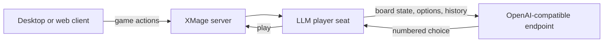

# What LLMage is

LLMage is a fork of XMage, the Java rules engine for Magic: The Gathering, with one substantial
change: opponents that decide what to do by asking a large language model. The cards, formats, and
rules enforcement are XMage's. The decisions are the model's.

This page explains what the fork adds, what an LLM opponent does during a game, what you need
before you install it, and which page to read next.

> **Who this is for:** a new user who has never run XMage and wants to play against an LLM opponent.

## XMage underneath

XMage enforces the full Magic rules on more than 31,000 cards and supports duel, multiplayer
free-for-all, Commander, Oathbreaker, Cube, Tiny Leaders, constructed formats, draft and sealed,
and tournaments. LLMage inherits all of that, including the desktop client, the server, the deck
editor, replays, and the rating system.

Inherited behaviour is documented upstream, not here: base XMage features, formats, and server
administration live in the [XMage wiki](https://github.com/magefree/mage/wiki). This wiki covers
what the fork adds. Fork-specific material is marked with a callout:

> **LLMage addition.** Text under this marker exists only in this fork.

## The three additions

| Addition | Where it lives | What it gives you |
|---|---|---|
| LLM player plugin | `Mage.Server.Plugins/Mage.Player.LLM` | A player type, `Computer - LLM`, that sends every game decision to an OpenAI-compatible endpoint |
| Web proxy and browser client | `Mage.WebProxy` | A Jetty 12 WebSocket proxy plus a React client, so a browser can play without the desktop client |
| Core patches | `Mage`, `Mage.Common`, `Mage.Client`, `Mage.Server` | The player-type constant, per-seat configuration transport, the personality registry, the game-log collector, and the streaming poller |

### The LLM player plugin

The plugin implements an XMage player whose methods — priority, mulligan, targeting, combat,
sideboarding — build a prompt and read back a choice. It is a plugin jar
(`mage-player-llm.jar`), loaded like any other player type.

### The web proxy and browser client

The proxy bridges a browser WebSocket to the XMage server's own protocol and serves the React
bundle. The browser client covers connect and login, the lobby, table creation, full play with
every prompt type, sideboarding, a deck editor, tournaments, spectating, replays, and a per-seat
LLM panel.

### Core patches

The engine needed small changes to carry an LLM seat: a `COMPUTER_LLM` player type, a serializable
per-seat configuration object that rides the match options, a 35-name personality registry, a
collector that records game events for post-game analysis, and a poller that pushes game state to
clients every 500 ms while a model is thinking.

## What an LLM opponent does

An LLM seat is not a heuristic bot with a language model bolted on. Every card-level decision a
human player would make is put to the model, with the full board state, the legal options, and the
conversation so far. Low-level mechanics such as mana payment stay in engine code. The engine keeps
a conversation per seat rather than asking isolated questions, so the model can carry a plan from
turn to turn.

Before the first turn, the model reads its decklist with complete card text and writes a gameplan:
archetype, win condition, ideal opening hands, key synergies, and sideboard intentions. That
gameplan is part of the system prompt for the rest of the game. Between games of a match it
proposes sideboard swaps from the cards it saw; after the game it writes a reflection on its own
play.

| Decision class | Examples |
|---|---|
| Priority and actions | Play a land, cast a spell, activate an ability, attack, pass |
| Mulligan | Keep or mulligan the opening hand |
| Targets and modes | Any target, modal spells, replacement effects, trigger order |
| Card selection | Tutors, Brainstorm, Ponder, imprint, piles, X values, amounts |
| Combat | Which creatures attack, which block, and how damage is ordered |
| Sideboard | Cards in and out between games of a match |

The model chooses from a numbered list; a rejected choice is explained to it and it tries again.
If the endpoint fails repeatedly, the game stops with an error naming the provider instead of
quietly falling back to heuristic play.

## Two clients, one server

The XMage server is the same process in both cases; only the client differs.

- **Desktop client** — the inherited Swing client, plus an **LLM Chat** window that shows each
  bot's conversation while it plays.
- **Web client** — the browser client served by the proxy on port 8090, with an **LLM** tab in the
  game's right rail that shows the same conversations.

Both connect to the server on port 17171. Play against an LLM seat from either one.

## Requirements

| Component | Needed for | Notes |
|---|---|---|
| JDK 21 | Building and running anything | The launch scripts pass JDK 21 module flags |
| Maven 3.9 or newer | Building from source | The repository ships source only |
| An OpenAI-compatible endpoint | LLM seats | Local Ollama, a hosted API, or any server that speaks the chat-completions API |
| Node.js and npm | The web client only | Builds the React bundle |
| Git | Getting the source | |

The build is the heaviest step: the full reactor needs a 9 GB Maven heap, so give the build
machine at least 10 GB of RAM. At runtime the server launcher starts with a 2 GB heap and the
desktop client with 4 GB. Disk use grows with the card database, saved games, and transcripts.

A machine that only runs the server does not need Node.js. A machine that only plays in a browser
does not need the desktop client.

## Project links and licence

- Upstream XMage: <https://github.com/magefree/mage>
- Upstream documentation: <https://github.com/magefree/mage/wiki>
- Licence: the fork and the upstream code are MIT. The desktop client distribution contains a
  GPL-3.0-or-later component and is conveyed under that licence.

Read `NOTICE`, `LICENSE.txt`, and `THIRD-PARTY-NOTICES.md` in the repository for the exact terms
and the list of bundled components.

Magic: The Gathering is a trademark of Wizards of the Coast LLC. This project is not affiliated
with, sponsored by, or endorsed by Wizards of the Coast or Scryfall. Card data and images are
fetched at runtime from public sources for personal, non-commercial use.

## Where to go next

| Section | Start here | What it covers |
|---|---|---|
| Getting started | [Quick start](quick-start.md) | The shortest path to a game |
| Player guide | [Desktop client](../player-guide/desktop-client.md) | Lobby, tables, controls, formats, LLM opponents |
| Operator guide | [Server configuration](../operator-guide/server-configuration.md) | Config file, providers, deployment, security |
| Developer guide | [Architecture](../developer-guide/architecture.md) | Modules, decision pipeline, build, tests |
| Reference | [Commands](../reference/commands.md) | Scripts, layout, shortcuts, troubleshooting |

## Related

- [Quick start](quick-start.md)
- [Installation](installation.md)
- [Your first game against an LLM](first-llm-game.md)
- [LLM opponents](../player-guide/llm-opponents.md)
