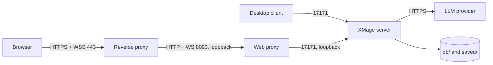

# Deployment

A complete LLMage deployment is two processes: the XMage game server and the web proxy that serves
the browser client and bridges its WebSocket traffic to the server. This page takes you from a
source checkout to a running, verified stack behind TLS, and covers the build flavours, the launch
scripts, detached operation, systemd, and the firewall shape that keeps the game server off the
public internet.

> **Who this is for:** an operator preparing a host for other players, not a developer changing
> the code.

## What runs where



| Process | Default port | Default bind | Serves |
|---|---|---|---|
| `mage.server.Main` | `17171` | value of `serverAddress` in `config.xml` | The game protocol. Desktop clients and the web proxy connect here. |
| Web proxy (Jetty) | `8090` | `127.0.0.1` | The React client over HTTP and the proxy WebSocket. |
| Reverse proxy | `443` | public interface | TLS termination and the public hostname. |

The web proxy speaks plain HTTP. TLS belongs in front of it, at a reverse proxy you already trust.

## Host prerequisites

| Component | Version | Used for |
|---|---|---|
| Java JDK | 21 | Server, proxy, and desktop client. |
| Maven | 3.9 or newer | One-time build from source. |
| Node.js and npm | current LTS | Building the web frontend. |
| `zstd` | any recent | Replay compression and the source backup script. |
| A reverse proxy | nginx, Caddy, or similar | TLS and the public hostname. |

## Build flavours

The game server has one flavour. The web proxy is built in three, from the same source tree, and
the difference is compiled in rather than switched at runtime.

| Flavour | How to build | Contents | Use it for |
|---|---|---|---|
| LLMage | `mvn -Pllmage` plus `npm run build` | LLM seat plumbing, the browser-key relay route, replay scrubber, sidecar metadata. | An LLMage server. This is the flavour the deploy script requires. |
| Minimal | plain `mvn install` | Same server-side code, no relay route. | Unit-test builds and proxy work that does not touch LLM features. |
| Stock | `-Pstock` plus `VITE_LLMAGE=false npm run build` | No LLM code in the JAR or the bundle; neutral branding. | Connecting to official XMage servers. |

`Mage.WebProxy/scripts/build-stock.sh` builds the stock pair and verifies that no LLM strings or
relay classes survived into the artifacts. A plain `mvn install` produces the minimal flavour,
which is safe to run but has no browser-key relay.

`deploy-release.sh` checks the deployed proxy JAR's manifest for the LLMage marker and stops if it
finds the stock value or no value at all. A minimal or stock proxy cannot be deployed by accident.

## Build and stage the release

The full reactor does not fit Maven's default heap. Set it for the build shell:

```bash
export MAVEN_OPTS=-Xmx9g
mvn clean install -DskipTests
```

Then produce the server assembly and stage the runtime tree:

```bash
(cd Mage.Server && mvn package assembly:single -DskipTests)
scripts/deploy-release.sh
```

`deploy-release.sh` reads `Mage.Server/target/mage-server.zip` for the list of JARs the runtime
needs, then copies each JAR's bytes from the owning module's `target/` directory or from the local
Maven repository. It verifies that every copied JAR opens before accepting it, and it compares the
deployed project JARs against their build outputs by checksum. Do not populate
`Mage.Server/release/lib/` by unzipping the assembly yourself: the assembled `lib/` entries are not
reliable, and a half-copied set loads zero cards.

Build the web client in two steps:

```bash
mvn -pl Mage.WebProxy install -DskipTests -Pllmage
(cd Mage.WebProxy/web/frontend/react && npm ci && npm run build)
```

The npm build writes `index.html` and `assets/` under `Mage.WebProxy/web/frontend/`. Both are build
outputs; never edit them.

## Release layout

| Path | Contents |
|---|---|
| `Mage.Server/release/lib/` | Server JARs and third-party dependencies. The server classpath. |
| `Mage.Server/release/plugins/` | The LLM player plugin and the web proxy JAR. |
| `Mage.Server/release/config/` | Packaged `config.xml`, sample `log4j.properties`, security policy. |
| `Mage.Server/release/startServer.sh` | Minimal upstream-style launcher. Prefer `scripts/start-server.sh`. |
| `Mage.WebProxy/target/` | Proxy JAR and its dependency directory. |
| `Mage.WebProxy/web/frontend/` | Built frontend bundle. |
| `plugins/` | Symlinks to the release JARs, recreated by `bootstrap-plugins.sh`. |

The proxy JAR belongs in `release/plugins/`, never in `release/lib/`. Both JARs carry a
`log4j.properties`, the JVM picks the first one on the classpath, and `lib/*` is searched first.
A proxy JAR in `lib/` silently redirects the server's logging to the console and no
`mageserver.log` is written.

## Configure and start the server

1. Choose the configuration file and edit the settings you need. At minimum, set
   `serverAddress`, confirm `port`, and decide on `saveGameActivated` and
   `authenticationActivated`. See [Server configuration](server-configuration.md).
2. Put the provider key in a file outside the repository and restrict it:

   ```bash
   KEY_FILE=<path-outside-repo>/provider.key
   install -m 600 /dev/null "$KEY_FILE"
   printf '%s' '<api-key>' > "$KEY_FILE"
   ```

3. Export the path and start:

   ```bash
   export LLM1_KEY="$(cat "$KEY_FILE")"
   scripts/start-server.sh
   ```

`scripts/start-server.sh` is the canonical configuration point for a source deployment. Before it
starts the JVM it archives the previous logs, recreates the plugin symlinks, assembles the JDK
module flags, and exports the provider keys. The remaining LLM settings become `-D` properties,
most sourced from an environment variable you can override.

| Aspect | `start-server.sh` | `start-server-charm.sh` |
|---|---|---|
| Configuration | Environment variables and `config.xml` | A provider preset selected by `XMAGE_LLM_PROVIDER`, then the same variables |
| Key source | `LLM1_KEY` / `LLM2_KEY` in the environment | Reads `$XMAGE_KEY_FILE`, exports it, then delegates |
| Seats configured | Primary and second seat separately | Both seats get the same provider, model, and effort |
| Default effort | `high` for the primary seat | `low`, overridable with `XMAGE_LLM_EFFORT` |
| Use it for | A local Ollama or any endpoint you configure by hand | A hosted provider where both seats share one key |

`start-server-charm.sh` refuses to start when `XMAGE_KEY_FILE` is set but unreadable, or unset with none of the fallback paths readable, and refuses
an empty key file. It has no fallback key path inside the repository, by design.

## Start the web proxy

```bash
scripts/start-proxy.sh                       # 127.0.0.1:8090
scripts/start-proxy.sh --port 8090
scripts/start-proxy.sh --bind 127.0.0.1
```

For a public deployment, keep the bind on loopback and put the reverse proxy in front. The
following environment variables are read by the launcher and turned into system properties:

| Variable | Property | Effect |
|---|---|---|
| `XMAGE_PROXY_PINNED_TARGET` | `webproxy.pinnedXmageTarget` | Forces every browser session to this `host:port`. Client-supplied targets are ignored. |
| `XMAGE_PROXY_HIDE_SERVER_TARGET` | `webproxy.hideServerTarget` | Hides the Server and Port fields on the connect form. Requires the pin above; the proxy refuses to start without it. |
| `XMAGE_ALLOWED_XMAGE_HOSTS` | `webproxy.allowedXmageHosts` | Hosts the proxy may dial. Defaults to loopback. |
| `XMAGE_ALLOWED_MODEL_HOSTS` | `webproxy.allowedModelHosts` | Hosts the model list and relay may reach. Defaults to loopback. |
| `XMAGE_PROXY_ALLOWED_ORIGINS` | `webproxy.allowedOrigins` | Extra origins accepted for the WebSocket upgrade. |
| `WEBPROXY_AUTH_TOKEN` | `webproxy.authToken` | Shared secret required on connect or registration; the proxy reads this variable itself, not the launcher. |

The launcher also forces IPv4 for its JVM. On a dual-stack host, `localhost` resolves to `::1`
first while the game server listens on IPv4, and the handshake fails with a misleading
"Server is likely offline". Use `127.0.0.1` in the connect form for the same reason.

## Run detached

A server started as a child of an interactive shell dies when that shell's session is torn down.
`launch-rig-detached.sh` double-forks through `setsid` so both JVMs re-parent away from the shell
and survive it:

```bash
scripts/launch-rig-detached.sh              # server plus proxy
scripts/launch-rig-detached.sh --plain      # default server settings, no preset
scripts/launch-rig-detached.sh --plain --no-proxy
```

The launcher refuses to start when a host XMage server process is already running, starts the
server, checks that the process is alive, then starts the proxy on `WEBPROXY_BIND` (default
`127.0.0.1`) and `WEBPROXY_PORT` (default `8090`). It prints the PID and parent PID of each process
and the console log path. To run only the proxy detached:

```bash
scripts/launch-proxy-detached.sh --bind 127.0.0.1 --port 8090
```

That launcher refuses to start when another host proxy is running and waits up to twenty seconds
for the port to accept a connection before reporting failure. Both launchers filter out processes
that belong to a container, so a containerised copy of the same JAR does not block a host start.

Detached processes have no supervisor. For anything long-lived, use systemd instead.

## Run under systemd

Two units, one per process. Run as an unprivileged account that owns the checkout and the data
directories.

```ini
# /etc/systemd/system/llmage-server.service
[Unit]
Description=LLMage game server
After=network-online.target
Wants=network-online.target

[Service]
Type=simple
User=llmage
WorkingDirectory=/opt/llmage
EnvironmentFile=/etc/llmage/server.env
ExecStart=/opt/llmage/scripts/start-server.sh
Restart=on-failure
RestartSec=10
TimeoutStopSec=60
NoNewPrivileges=true
PrivateTmp=true
ProtectSystem=strict
ProtectHome=true
ReadWritePaths=/opt/llmage

[Install]
WantedBy=multi-user.target
```

```ini
# /etc/systemd/system/llmage-proxy.service
[Unit]
Description=LLMage web proxy
After=llmage-server.service
Requires=llmage-server.service

[Service]
Type=simple
User=llmage
WorkingDirectory=/opt/llmage
EnvironmentFile=/etc/llmage/proxy.env
ExecStart=/opt/llmage/scripts/start-proxy.sh --bind 127.0.0.1 --port 8090
Restart=on-failure
RestartSec=5
NoNewPrivileges=true
PrivateTmp=true
ProtectSystem=strict
ProtectHome=true
ReadWritePaths=/opt/llmage

[Install]
WantedBy=multi-user.target
```

`server.env` holds `LLM1_KEY` (the literal key value) and any `LLM*` overrides. Create it mode `600` and owned by
the service account; systemd reads it as root before dropping privileges. `proxy.env` holds
`WEBPROXY_AUTH_TOKEN` and the allowlist variables. Keeping secrets in environment files avoids
putting them on a command line, where any local user can read them.

The launchers change into the repository root themselves, so `WorkingDirectory` mainly decides
where relative data directories land. Keep it at the checkout root so `db/`, `saved/`, and
`gamelogs/` stay together.

`ProtectSystem=strict` makes everything read-only except `ReadWritePaths`. If you move the data
directories outside the checkout, add those paths to `ReadWritePaths` as well.

## Put TLS in front

Terminate TLS at the reverse proxy and forward both ordinary requests and the WebSocket upgrade to
the proxy port. An nginx site:

```nginx
server {
    listen 443 ssl;
    server_name example.com;

    ssl_certificate     /etc/letsencrypt/live/example.com/fullchain.pem;
    ssl_certificate_key /etc/letsencrypt/live/example.com/privkey.pem;

    location / {
        proxy_pass http://127.0.0.1:8090;
        proxy_http_version 1.1;
        proxy_set_header Upgrade $http_upgrade;
        proxy_set_header Connection "upgrade";
        proxy_set_header Host $host;
        proxy_set_header X-Forwarded-For $proxy_add_x_forwarded_for;
        proxy_set_header X-Forwarded-Proto $scheme;
        proxy_read_timeout 3600s;
    }
}
```

Caddy needs no explicit upgrade configuration; a `reverse_proxy 127.0.0.1:8090` directive handles
WebSocket traffic.

Two settings matter when the proxy goes public:

- Add the exact public origin to the proxy's origin allowlist, for example
  `XMAGE_PROXY_ALLOWED_ORIGINS=https://example.com`. The proxy rejects a WebSocket upgrade from an
  origin it does not recognise: the page loads and then never connects.
- When the connect form should not expose the game server address, set
  `XMAGE_PROXY_PINNED_TARGET=127.0.0.1:17171` and `XMAGE_PROXY_HIDE_SERVER_TARGET=true` together.

The proxy has no TLS of its own. Do not expose port 8090 directly to the internet.

## Firewall and network exposure

| Port | Expose publicly | Reason |
|---|---|---|
| `443` | Yes | TLS front end for the web client. |
| `8090` | No | Plain HTTP and WebSocket. Loopback only. |
| `17171` | Only for desktop clients | The game protocol has no transport encryption. Reach it over a private network or a tunnel, not the open internet. |

A web-only deployment needs one inbound port. A deployment that also serves desktop clients needs
a private path to `17171`, such as a VPN, and a firewall rule that admits only that network.

## Verify a deployment

```bash
ss -ltn | grep -E ':(17171|8090)\b'          # both sockets listening
curl -fsS http://127.0.0.1:8090/config       # build flavour and hidden-target flags
tail -n 50 mageserver.log                    # "Started MAGE server - listening on ..."
```

Then open the site, connect as `Player One`, create a two-player table, and add an LLM seat. A table
that refuses the seat points at a missing plugin; a seat that is added but never starts points at
the provider configuration. Both leave a line in the server log.

Base XMage behaviour is documented in the [upstream XMage wiki](https://github.com/magefree/mage/wiki).

## Related

- [Server configuration](server-configuration.md)
- [LLM providers](llm-providers.md)
- [Operations](operations.md)
- [Security](security.md)
- [Building](../developer-guide/building.md)
- [Web client](../player-guide/web-client.md)
