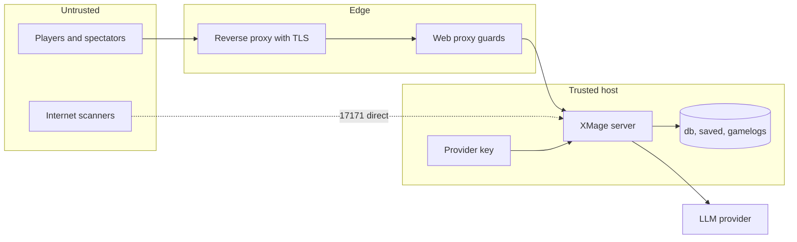

# Security

An LLMage server is a game server with an outbound API bill attached. The risks are concrete:
someone using your provider key, someone reading other players' replays and transcripts, someone
reaching the game port directly, past every web-client guard, and someone knocking the server over
during a game. This page describes the trust boundaries, the guards the fork adds, and the settings
that decide whether those guards are doing anything.

> **Who this is for:** an operator exposing a server to people you do not personally know.

## Trust model



The browser, the game protocol, and provider responses are untrusted input. The host, the
configuration file, and the key file are trusted.

The guards below are additions in this fork. They exist because the web proxy puts many browsers
behind one source address, which breaks assumptions the server makes about same-host connections.

## Authentication and accounts

Guest mode is the default (`authenticationActivated="false"`). A user name is a claim, not an
account: there is no password, no registration, and no ownership of a name beyond holding the
connection. The server allows one live instance per name. With guest mode on, a second connection
using a name that is already connected from the same host silently replaces the first.

Registered mode (`authenticationActivated="true"`) gives users passwords, persistent names, and
stats. It needs a working mail path for registration and password reset, either Mailgun or SMTP;
see [Server configuration](server-configuration.md#authentication).

Three credentials sit outside user accounts:

| Credential | Set with | Protects |
|---|---|---|
| Admin password | `-Dxmage.adminPassword=<password>` | The admin console: list, disconnect, mute, lock, activate, remove tables, broadcast. |
| Proxy auth token | `WEBPROXY_AUTH_TOKEN`, or `-Dwebproxy.authToken` | The proxy's WebSocket. A client must present it on connect or registration. |
| Provider key | `LLM1_KEY` / `LLM2_KEY`, or `$XMAGE_KEY_FILE` | Your account at the LLM provider. |

Two defaults matter. With no admin password, the check compares against an empty string, so anyone
who can reach the port with an admin client connects as administrator. With no proxy auth token,
the proxy accepts every connection: fine on loopback, wrong in public.

## Anonymous name guard

The server's guest mode identifies anonymous users by host. When two connections present the same
name from the same address, the newer one wins and the older is disconnected silently. Every
browser through the proxy appears to come from the proxy's address, so without a guard any two web
users picking the same name would kick each other in a loop, each reconnect kicking back.

The proxy refuses the second connection instead: the newcomer receives a `connect_error` saying the
name is in use, and the socket closes with code `4401`. The older session is never touched, so the
refusal cannot start a kick loop.

Refinements:

- A reconnect from the **same browser** is allowed. The browser sends a persistent identifier with
  every connect; a same-name connect carrying the same identifier is treated as a page refresh and
  takes the name over.
- A name only collides within one target server. A proxy that can reach two servers does not block
  `Player One` on one because `Player One` is connected to the other. Comparison is
  case-insensitive, matching the server's own user lookup.

The name registration belongs to the session that made it and is released on every teardown path,
including a failed dial after registration.

## Per-host connection limiting

A proxy presents one source address to the game server. Without a limit, a runaway client can
exhaust the server's connection pool, and the address can look like a bot farm.

```bash
JAVA_TOOL_OPTIONS=-Dwebproxy.maxConnectionsPerHost=64 scripts/start-proxy.sh
```

The value is a positive integer, or `0` or unset for unlimited, which is the default. A value that
is not a non-negative integer stops the proxy at boot rather than silently degrading to unlimited.
A slot is reserved before the dial and released when the session ends, so a burst of simultaneous
attempts cannot overshoot the cap. The count is per resolved `host:port` target and per session,
not per TCP connection.

This limit is about resource use, not authentication. It does not distinguish users.

## Table ownership

The game server knows who created a table, but the browser learns it only from its own
table-creation response. After a page reload the browser has no ownership signal, and a table whose
owner holds no seat at it shows no start control to anyone.

The proxy asks the server through the ownership RPC and puts the answer on the table list. The
cache is keyed by user name:

- A positive answer is kept for the lifetime of the proxy process, because ownership of a live
  table cannot change.
- A negative answer is provisional for 120 seconds. A probe can fail for reasons unrelated to
  ownership, and a cached negative would hide the owner's start control until the proxy restarted.
- At most 64 tables per account and 64 accounts are tracked, least recently used evicted first.

The flag is a fact about an RPC the proxy ran, never a browser claim, so a client cannot promote
itself to table owner.

## Start-game join gate

The server re-sends the start event for a game it believes was not fully joined, and a rejoin can
produce a duplicate. The proxy answers a duplicate callback with another join handshake and
another chat join unless it is gated.

The gate keys on the game identifier and runs the work once per connection. A best-of-three match
still joins the next game because the identifier changes; a page reload gets a new connection and
re-joins, which is what the rejoin path needs.

## Origin and target allowlists

Three allowlists bound what the proxy will talk to.

| Guard | Property | Default | Blocks |
|---|---|---|---|
| WebSocket origin | `webproxy.allowedOrigins` | loopback origins, any port | Cross-site WebSocket hijacking: a page on another origin opening a socket to your proxy with the user's browser. |
| Game target | `webproxy.allowedXmageHosts` | `localhost,127.0.0.1,::1` | Server-side request forgery through the connect form: making the proxy dial an arbitrary internal host and port. |
| Model target | `webproxy.allowedModelHosts` | loopback | Using the model list or the relay as a port scanner or an internal-service client. |

If the proxy is bound to a non-loopback interface, add the exact public origin, including scheme
and port, to the origin allowlist. The UI loads and then never connects when the origin is missing;
that failure is the guard, not a bug.

The hidden-target mode is a pair, not a single switch. `webproxy.hideServerTarget=true` removes the
Server and Port fields from the connect form, and it requires
`webproxy.pinnedXmageTarget=host:port`. The proxy refuses to start with one and not the other,
because a browser with neither a visible target nor a pinned one cannot connect at all.

## Spectator hand requests

Every web connection, including a pure watcher, is created with the server-side right to request
another player's hand. That is convenient when the operator watches their own games on loopback
and wrong for a public server.

```bash
JAVA_TOOL_OPTIONS=-Dwebproxy.allowShowHandCards=false scripts/start-proxy.sh
```

Set it `false` for any server other than a loopback one. The web UI still lets a player reveal
their own hand; what disappears is every watcher's ability to ask.

## Key handling

Provider keys follow three rules.

1. **Never on a command line.** A `-D` property and a program argument are both readable from the
   process command line by any local user. Keys travel in the environment (`LLM1_KEY`,
   `LLM2_KEY`) or in a file named by `$XMAGE_KEY_FILE`, which the hosted launcher reads and
   exports.
2. **Never inside the repository.** The key file must live outside the checkout. The hosted
   launcher has no in-repository fallback on purpose: a key in the tree is one commit away from
   publication. Create the file mode `600` and keep it out of host backups that leave your control.
3. **Never in a replay.** The runtime key field is transient, so a `.game` save cannot carry it.
   This is pinned by a test because the seat-config object that travels from client to server is a
   different class and does carry a key.

A per-seat override that changes the endpoint and supplies no key clears the inherited server key
rather than sending it to the new host. Without that rule, a player who can edit a seat could point
the seat at their own endpoint and receive your key as a Bearer header.

The client-key bridge is the alternative for public servers: the seat is marked as client-key, the
server holds no key for it, and each request body is handed to the seat owner's browser, which
attaches the key and calls the provider. The relay route only reaches hosts on the model allowlist,
and the stock build has no relay route compiled in at all.

`llm2ApiKey` in `config.xml` is a plaintext key in a file that operators copy between hosts. Leave
it empty and use the environment.

## Transport security

The web proxy speaks plain HTTP. TLS terminates at the reverse proxy in front of it. Two rules
follow:

- Bind the proxy to loopback (`--bind 127.0.0.1`) and publish only the reverse proxy's TLS port.
- Keep the game port off the public internet. The protocol has no transport encryption and no
  per-message authentication beyond the session; anyone who can reach `17171` can attempt to
  connect, claim a name, or try the admin console.

The client stores no session cookie: the proxy token is carried in the connect message. There is no
cookie attribute to harden. Configure HSTS at the front end and keep certificates renewed; an
expired certificate turns every WebSocket upgrade into a browser error that looks like an outage.

## Exposed endpoints

| Endpoint | Protocol | Authentication | Exposure |
|---|---|---|---|
| `443` | HTTPS and WSS | Guest name or account, plus the optional proxy token | Public. |
| `8090` | HTTP and WS | Proxy token when configured | Loopback only. |
| `17171` | XMage remoting | Guest name or account, plus the admin console password for admin clients | Private network or tunnel only. |

## Replay and transcript privacy

Replay data is more revealing than it looks.

| Artifact | Contains |
|---|---|
| `saved/<uuid>.game` | The full game state at every step, both players' hands and libraries as the game progressed, all chat, and each LLM seat's prompts, answers, and reasoning. |
| `saved/<uuid>.json` | Game and table identifiers, table name, format, player names, deck names, win counts, winner, and timestamps. |
| `gamelogs/game_<id>/` | Full prompts, including the deck list, every model response, and post-game analysis text. |
| `mageserver.log` | Endpoints, model names, errors, user names, and admin actions. |

Provider keys are absent from all of them. Player names, deck names, and conversations are not.
Treat `saved/` and `gamelogs/` as personal data: restrict their permissions to the service account,
keep them out of public file shares, and prune them on a schedule. Before sharing a replay or
transcript beyond the group that played the game, read it; the sidecar alone names the players and
the table.

## Hardening checklist

1. Set an admin password and a proxy auth token.
2. Run both processes as an unprivileged account, with the data directories owned by it.
3. Bind the proxy to loopback; terminate TLS in front of it.
4. Add the public origin to the origin allowlist and keep every other origin out.
5. Keep `allowedXmageHosts` and `allowedModelHosts` at loopback unless a remote provider is
   genuinely required, and add only the hosts you use.
6. Set `allowShowHandCards=false` on a public server.
7. Set `maxConnectionsPerHost` to a value your server can serve.
8. Keep the key file outside the repository, mode `600`.
9. Leave guest mode on only if you accept that names are claims; otherwise enable registration and
   configure mail.
10. Schedule replay retention and archive or delete rotated logs.
11. Update the server and the proxy together so the capability probe sees the new features.

## What these guards do not do

- There is no per-user account on the proxy: anyone with the token, or anyone at all when no token
  is set, can open a WebSocket. The rate limiters are per session (table creation, model and
  personality fetches), not per address.
- There is no encryption at rest for databases, replays, or transcripts, and no audit trail beyond
  the server and proxy logs.
- There is no anti-cheat for human players; the server trusts each client's report of its own
  actions, as upstream XMage does.
- The admin password, when passed as a JVM property, is visible in the process command line. Host
  access is admin access regardless.

## Related

- [Server configuration](server-configuration.md)
- [Deployment](deployment.md)
- [LLM providers](llm-providers.md)
- [Operations](operations.md)
- [Web client](../player-guide/web-client.md)
- [Troubleshooting](../reference/troubleshooting.md)
