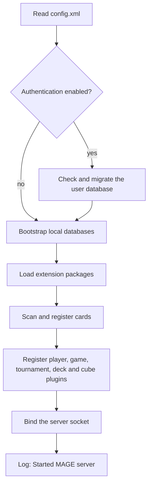

# Server configuration

The XMage server reads one XML file at startup and derives almost everything else from the
directory it runs in: ports, user limits, plugin lists, where replays and databases are written,
and the default LLM seat settings. This page explains that file, the runtime directories, the JVM
and environment settings the launchers apply, and the order in which the server brings itself up.
Most "the server will not start" and "the cards are missing" reports trace back to one of these.

> **Who this is for:** anyone self-hosting an LLMage server who needs to change its behaviour or
> diagnose a startup problem.

## Where the configuration lives

The server loads `config/config.xml` relative to its working directory unless you tell it
otherwise. The launchers in `scripts/` change into the repository root first, so the effective
default is `Mage.Server/config/config.xml`.

| Source | Effect |
|---|---|
| `-Dxmage.config.path=<path>` | Absolute or relative path to the configuration file. Highest priority. |
| `XMAGE_CONFIG_PATH` | Read by `scripts/start-server.sh` and passed through as `-Dxmage.config.path`. |
| `config/config.xml` | Fallback when neither of the above is set. |

Two copies ship in the tree. `Mage.Server/config/config.xml` is the development configuration and
enables replays. `Mage.Server/release/config/config.xml` is the packaged release configuration and
disables them. Pick one as authoritative, point `XMAGE_CONFIG_PATH` at it, and edit only that copy.
A release deploy refreshes the release copy, so local edits made there can be overwritten.

The file is read by a plain XML unmarshaller with no schema validation. A malformed document fails
to load with a parse error naming the file; a missing attribute is not caught there and surfaces
later as a null value when the server reads it, usually as a startup failure. Copy a shipped file
and edit values instead of trimming attributes.

## Startup sequence



Two log lines matter during this sequence:

- `Started MAGE server - listening on ...` means the socket is bound and clients can connect.
- `Unable to start MAGE server - another server is already started` means something already holds
  the configured port. The process exits without taking over; find and stop the other instance.

Card scanning is the slow part of a cold start on a large set list. The server logs
`Loading cards...` before it and `Done.` after it. A start that reaches `Loading cards...` and then
logs nothing for minutes is usually still scanning, not hung.

## Server settings

These attributes live on the `<server>` element.

| Attribute | Shipped value | Meaning |
|---|---|---|
| `serverAddress` | `127.0.0.1` (dev), `0.0.0.0` (release) | Interface the server binds. Use `0.0.0.0` only when clients on other hosts must connect directly. |
| `serverName` | `mage-server` | Name shown to clients. |
| `port` | `17171` | Primary client port. Every desktop client and the web proxy dial this. |
| `secondaryBindPort` | `17179` (dev), `-1` (release) | Second listening port. `-1` lets the operating system choose. |
| `backlogSize` | `200` | Pending connection queue. Requests beyond it are refused. |
| `numAcceptThreads` | `2` | Threads accepting new connections. |
| `maxPoolSize` | `300` | Maximum request worker threads. Size it well above peak concurrent users; a useful starting point is twenty workers per expected online player. |
| `leasePeriod` | `5000` | Client lease in milliseconds, used for connection failure detection. |
| `socketWriteTimeout` | `10000` | Write timeout in milliseconds. |
| `maxGameThreads` | `10` | Games that can run at the same time. |
| `maxSecondsIdle` | `600` (release), `300` (dev) | Seconds of inactivity after which an idle player auto-concedes. |
| `minUserNameLength` / `maxUserNameLength` | `3` / `14` | Accepted user-name length. |
| `invalidUserNamePattern` | `[^a-z0-9_]` | Characters rejected in a user name. The pattern describes what is invalid, not what is allowed. |
| `minPasswordLength` / `maxPasswordLength` | `8` / `100` | Accepted password length for registered accounts. |
| `maxAiOpponents` | `15` | Computer opponents a table may add. Draft bots are not counted. |
| `saveGameActivated` | `true` (dev), `false` (release) | Enables saving finished games to `saved/` and, with it, game-log capture. Set it explicitly. |
| `authenticationActivated` | `false` | `false` runs in guest mode; `true` requires registration. |

`saveGameActivated` has a second effect that is easy to miss: the server only accumulates the
in-game log when saving is on. Turning saving off also turns off the Game Log tab in the replay
viewer for every game, including games played with LLM seats.

## Authentication

With `authenticationActivated="false"` the server accepts anonymous connections. A name is a
claim, not an account: two clients on the same host that pick the same name fight over it, and the
newer connection wins. The web proxy adds a guard for that case; see
[Security](security.md#anonymous-name-guard).

With `authenticationActivated="true"` users register, log in, and keep their name and stats. The
server then needs a way to send registration and password-reset mail. Leave `mailUser` empty to
send through Mailgun (`mailgunApiKey`, `mailgunDomain`), or set `mailSmtpHost`, `mailSmtpPort`,
`mailUser`, `mailPassword`, and `mailFromAddress` to use an SMTP server directly. Registration
fails at the point where a message must be sent if neither path is configured.

Two passwords sit outside the XML file:

- The **admin password** is passed as `-Dxmage.adminPassword=<password>` (or `-adminPassword=` on
  the command line). It unlocks the admin console: list users, disconnect, mute, lock, activate,
  remove tables, and broadcast a message. With no password configured the comparison is made
  against an empty string, so set one before the port is reachable by anyone else. A JVM property
  is visible in the process command line, so treat host access as equivalent to admin access.
- **LLM provider keys** are delivered through the environment rather than a `-D` flag. Leave
  `llm2ApiKey` empty in the file. See [LLM providers](llm-providers.md#key-handling).

## Plugin lists

Five lists select what the server can host: `<playerTypes>`, `<gameTypes>`, `<tournamentTypes>`,
`<deckTypes>`, and `<draftCubes>`. Each entry names a display name, a JAR file, and a class. The
`jar` attribute is a bare file name resolved from the `plugins/` directory, not a path.

The server resolves those files through `plugins/`, which is populated with symlinks to the built
release JARs. `scripts/bootstrap-plugins.sh` recreates every link from the JARs under
`Mage.Server/release/lib/` and fails loudly on a dangling link. Run it after every deploy and
before the first start on a fresh checkout.

Symptoms of a missing or stale link:

| Symptom | Cause |
|---|---|
| `Unknown player type: Computer - LLM` at table creation | `mage-player-llm` is not linked in `plugins/`, or the JAR is absent from the release tree. |
| A seat never joins and the table waits forever | Same, for the game or player plugin the table type needs. |
| `can't load any game types` in the log | The `<gameTypes>` list is empty or points at JARs that do not exist. |

## LLM defaults in the configuration file

The `<server>` element also carries LLM defaults for the bot-game handler: the path behind the
in-client `\botgame` command and the headless game runner. Table seats read the JVM properties and
their own per-seat values instead, so keep the two sources in step.

| Attribute | Purpose |
|---|---|
| `llmReasoningEffort` | Default effort for the primary seat: `low`, `medium`, `high`, or `max`. |
| `llmTranscriptDir` | Directory for full conversation transcripts. Empty disables them. |
| `llm2Endpoint`, `llm2Model`, `llm2ReasoningEffort` | Defaults for the second LLM seat used by LLM-versus-LLM games. Empty values inherit the primary seat. |
| `llm2ApiKey` | Second-seat key. Leave it empty and use the environment instead. |

A JVM property of the same name always wins over the file. The complete property list, the
precedence rules, and the per-seat overrides are on the [LLM providers](llm-providers.md) page.

## Runtime directories

Every path below is relative to the process working directory. The launchers change into the
repository root, so these are all top-level directories there. Starting the server by hand from
another directory creates a second, empty set.

| Directory | Contents | Grows with |
|---|---|---|
| `db/` | Card, user, table-record, and stats databases. | Card sets, accounts, finished games. |
| `saved/` | Replay saves (`<uuid>.game`) and their metadata sidecars (`<uuid>.json`). | Every saved game. Multi-megabyte files are normal. |
| `gamelogs/` | LLM conversation transcripts, one directory per game. | Every LLM game. |
| `gamelogsJson/` | JSON game logs written by clients that request them. | Every game on those clients. |
| `gamesHistory/` | Game history records. | Every game. |
| `oldlogs/` | Rotated logs and game-log directories moved aside by `archive-logs.sh`. | Each server start. |
| `plugins/` | Symlinks to the release JARs. Rebuildable at any time. | Deploys only. |
| `extensions/` | Optional extension packages, one directory per package. | Operator-installed packages. |

Sizes, retention, and backup of these directories are covered in [Operations](operations.md).

## Logging

The server ships a log4j configuration inside its JAR and uses it by default. A sample external
configuration sits in `config/log4j.properties` and is only used when you ask for it:

```bash
-Dlog4j.configuration=file:./config/log4j.properties
```

The sample defines a console appender, an unrolled file appender, a size-rolled appender
(10 MB per file, five backups), and a daily-rolled appender. Only the appenders named on
`log4j.rootLogger` are active. The shipped default writes `mageserver.log` in the working
directory at `info` level.

> **LLMage addition.** The web proxy JAR carries its own `log4j.properties`. The JVM resolves that
> file by classpath order, and `lib/*` comes before `plugins/*`, so a proxy JAR left in
> `Mage.Server/release/lib/` makes the server boot with the proxy's logging configuration: no
> `mageserver.log` is written at all. `deploy-release.sh` refuses to finish if it finds one there.
> If the server runs but the log file is missing, check for a stray `mage-web-proxy-*.jar` in
> `lib/` first.

## JVM settings

The launchers pass a fixed set of `--add-opens` flags. JBoss Remoting reflects into JDK internals
that Java 21 no longer exports, and without those flags the server fails at startup with an
inaccessible-object error. Use `scripts/start-server.sh` rather than a hand-written `java`
command, or copy the flag block from it.

Heap is set by `XMAGE_SERVER_HEAP` and defaults to `2g`. An idle server holds roughly 150 MB after
garbage collection; a replay session walks a saved game of tens of megabytes and needs several
hundred. Raise the value for replay-heavy or many-table deployments:

```bash
XMAGE_SERVER_HEAP=4g scripts/start-server.sh
```

Other JVM properties the server understands:

| Property | Effect |
|---|---|
| `xmage.config.path` | Configuration file to load. |
| `xmage.adminPassword` | Admin console password. |
| `xmage.testMode` | Development mode: fast buttons, cheat commands, no deck validation. Never enable it on a public server. |
| `xmage.detailsMode` | Extra detail in error responses. |

## Environment variables

The launchers translate environment variables into the JVM properties above. Setting the
environment is preferred for anything secret, because a JVM property is readable from the process
command line by any local user.

| Variable | Read by | Effect |
|---|---|---|
| `XMAGE_CONFIG_PATH` | server launcher | Configuration file path. |
| `XMAGE_SERVER_HEAP` | server launcher | `-Xmx` value. |
| `LLM1_MODEL`, `LLM1_ENDPOINT`, `LLM1_EFFORT` | server launcher | Primary LLM seat defaults. |
| `LLM2_MODEL`, `LLM2_ENDPOINT`, `LLM2_EFFORT` | server launcher | Second LLM seat defaults. |
| `LLM1_KEY`, `LLM2_KEY` | server process | Provider keys. Exported, never passed as flags. |
| `LLM_CONV_MAX_EXCHANGES`, `LLM_CONV_MAX_CHARS`, `LLM_CONV_THINK_CHARS_PER_MSG` | server launcher | Conversation memory limits. `0` means unlimited. |
| `LLM_SUMMARIZE_CONTEXT_RATIO`, `LLM_SUMMARIZE_TARGET_RATIO`, `LLM_SUMMARIZE_KEEP_EXCHANGES` | server launcher | Summarization thresholds. |
| `LLM_MAX_TOKENS`, `LLM_EFFORT_LEVELS` | server launcher | Output cap and retry descent ladder. |
| `XMAGE_KEY_FILE` | hosted launcher | File containing the provider key. Must live outside the repository. |
| `XMAGE_LLM_PROVIDER`, `XMAGE_LLM_ENDPOINT`, `XMAGE_LLM_MODEL`, `XMAGE_LLM_EFFORT` | hosted launcher | Provider preset and its overrides. |
| `WEBPROXY_AUTH_TOKEN` | web proxy | Shared secret required on connect. |

Precedence, highest first: a JVM `-D` property, then the matching `config.xml` attribute, then the
built-in default. The second LLM seat falls back to the primary seat's value for streaming,
verbosity, and the conversation memory limits when its own property is unset.

## Changing configuration safely

There is no hot reload. Configuration is read once, at startup.

1. Stop the server.
2. Edit the authoritative `config.xml`.
3. Start it again and read the first thirty lines of the log. The server echoes the effective
   values it loaded: address, port, game threads, idle timeout, AI opponent limit, name and
   password rules, save-game state, pool sizes, registration mode, and mail settings.
4. Confirm `Started MAGE server` appears, then connect a client and create a table.

If a change makes the file unparseable, the server stops before binding the port. Keep the previous
copy until the new one has started cleanly.

Base XMage behaviour is documented in the [upstream XMage wiki](https://github.com/magefree/mage/wiki).

## Related

- [Deployment](deployment.md)
- [LLM providers](llm-providers.md)
- [Operations](operations.md)
- [Security](security.md)
- [File layout](../reference/file-layout.md)
