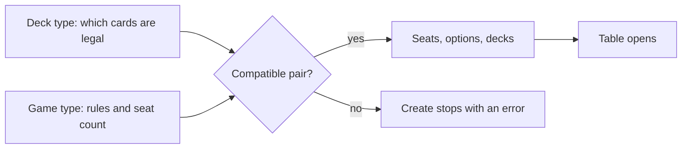

# Game modes

A table in LLMage is defined by two choices that must agree: the **deck type**, which decides which cards are legal, and the **game type**, which decides the rules variant and the number of seats. Tournaments add a third choice, the tournament type. This page explains how the choices fit together, which combinations the client accepts, and how LLM seats behave in each kind of event.

> **Who this is for:** players who create tables and tournaments, or who want to know what a listed game will be like before joining.

## Two choices before a game

The deck type is a validator. It checks deck size, copy limits, banned and restricted lists, the commander, and the set legality of every card. The game type is a rules engine: a duel has exactly two seats, a free-for-all has three to ten, and a Commander table starts with a commander in the command zone.

Both lists come from the server. LLMage adds no formats of its own; the validators and game types are the inherited XMage plugins. The New Table dialog's **Deck Type** list is therefore the authoritative list for the server you are on.

## Deck types and their game types

Most deck types work with a duel or a free-for-all. The variant deck types are tied to a matching game type, and the client refuses a mismatched pair with an error that names the expected family.

| Deck type family | Requires a game type starting with |
|---|---|
| Commander, Duel Commander, MTGO 1v1 Commander, Centurion Commander, Penny Dreadful Commander | `Commander` |
| Freeform Commander | `Freeform Commander` |
| Freeform Unlimited Commander | `Freeform Unlimited Commander` |
| Brawl, Duel Brawl | `Brawl` |
| Tiny Leaders | `Tiny Leaders` |
| Momir Basic | `Momir Basic` |
| Oathbreaker | `Oathbreaker` |
| Standard, Modern, Pioneer, Legacy, Vintage, Pauper, Premodern, block and Old School variants, Highlander variants | Any game type except the Commander, Freeform Commander, Brawl, Tiny Leaders and Oathbreaker families |

A Commander game type also accepts the Commander deck-type family, so a Commander free-for-all can be played with a Duel Commander or MTGO 1v1 Commander deck list. Pick the validator whose ban list you want enforced.

## Game types

The seat count and the sideboard allowance come from the game type.

| Game type | Seats | Sideboard between games |
|---|---:|---|
| Two Player Duel | 2 | Yes |
| Free For All | 3–10 | Yes |
| Commander Two Player Duel | 2 | No |
| Commander Free For All | 3–10 | No |
| Freeform Commander Two Player Duel | 2 | No |
| Freeform Commander Free For All | 3–10 | No |
| Freeform Unlimited Commander | 2–10 | Yes |
| Brawl Two Player Duel | 2 | No |
| Brawl Free For All | 3–10 | No |
| Oathbreaker Two Player Duel | 2 | No |
| Oathbreaker Free For All | 3–10 | No |
| Tiny Leaders Two Player Duel | 2 | Yes |
| Canadian Highlander Two Player Duel | 2 | No |
| Momir Basic Two Player Duel | 2 | Yes |
| Momir Basic Free For All | 3–10 | No |
| Penny Dreadful Commander Free For All | 3–10 | No |
| Custom Pillar of the Paruns Two Player Duel | 2 | Yes |

Free-for-all games also expose two multiplayer settings in the New Table dialog:

- **Range of Influence** limits how many seats away a player can affect the game.
- **Attack Option** decides whether a creature can attack several players at once.

Both settings are disabled for game types that do not use them. The inherited format rules — commander damage, colour identity, the points list in Canadian Highlander, Momir's random creatures — are documented in the [XMage wiki](https://github.com/magefree/mage/wiki).

## Commander and its variants

Commander is a family of game types with its own deck validators. You choose a Commander game type, a Commander deck type, and a legal deck with a commander.

- **Commander** — the 100-card singleton format, in a duel or a free-for-all. The `Commander` validator enforces the ban list and the colour identity of the commander.
- **Duel Commander and MTGO 1v1 Commander** — two-player Commander with their own ban lists. Use the matching validator.
- **Centurion Commander** — a two-player Commander variant with its own deck rules.
- **Penny Dreadful Commander** — Commander restricted to the Penny Dreadful card pool.
- **Freeform Commander** — Commander structure with a relaxed card pool, intended for casual tables.
- **Freeform Unlimited Commander** — the same idea without the usual deck-size restriction, and the only Commander game type that allows sideboarding.
- **Brawl** — a smaller singleton format with a commander, in a duel or a free-for-all.
- **Tiny Leaders** — a two-player singleton format with a low mana-value ceiling.
- **Oathbreaker** — a planeswalker and a signature spell lead the deck, in a duel or a free-for-all.
- **Canadian Highlander** — a two-player singleton format that uses a points list instead of a ban list.

None of the Commander game types allows a sideboard between games, apart from Freeform Unlimited Commander. If your plan depends on a sideboard, check the table before you join.

## Constructed formats

Constructed deck types in the New Table list cover the usual tournament formats and several historical ones:

| Family | Examples in the list |
|---|---|
| Current and recent constructed | Standard, Modern, Pioneer, Legacy, Vintage, Pauper, Premodern |
| Block constructed | One entry per block, such as Innistrad Block or Khans of Tarkir Block |
| Old School | Several rules variants of Old School 93/94 |
| Singleton, Highlander and freeform | Canadian Highlander, European Highlander, Australian Highlander, Freeform |
| Commander family | The variant deck types listed above |

Every constructed table validates all decks before the game starts, and the same validator runs again if a player changes a deck between games of a match.

## Limited: draft, sealed, and cube

Draft and sealed are tournament types, not standalone tables. You create them with **New Tournament**, not **New Table**.

| Tournament type family | Seats | Boosters |
|---|---:|---:|
| Booster Draft Swiss, Booster Draft Elimination | 4–16 | 3 |
| Booster Draft Random (chaos draft) | 4–16 | 3 |
| Booster Draft Reshuffled (mixed sets) | 4–16 | 3 |
| Booster Draft Rich Man (a new booster for every pick) | 2–16 | 1 |
| Booster Draft Cube, Booster Draft Elimination Cube | 4–16 | 3 |
| Rich Man Cube | 2–16 | 1 |
| Sealed Swiss, Sealed Elimination | 2–16 | 6 |
| Sealed Cube | 2–16 | 6 |
| Jumpstart Swiss, Jumpstart Elimination, Jumpstart Custom | 2–16 | none |

A draft tournament shows three pack columns, the current pick number and a pick timer. Each player picks a card and passes the pack; the client keeps the other players' names and pick counts visible. A sealed tournament opens the deck editor on your card pool after the boosters are opened.

**Cube** is a draft option rather than a game type. In the New Tournament dialog, the **Draft Cube** list contains the cubes the server ships plus an entry named `Cube From Deck`. Choosing `Cube From Deck` makes the client ask for a deck file; that file becomes the cube, and the client refuses to create the tournament if the file has no cards. Cube boosters are generated from the cube definition, not from a printed set.

## Tournaments

**New Tournament** collects a tournament type, a deck type, a game type, a seat count and one row per player. Constructed tournaments expect a deck file for each seat; limited tournaments do not, because the deck is built from the drafted or opened pool.

| Setting | Effect |
|---|---|
| Tournament Type | Swiss or elimination, constructed, draft, sealed or Jumpstart. |
| Deck Type, Game Type | The same validators and rules variants as a normal table. |
| Draft Cube | The cube used by a cube draft. |
| Number of Swiss Rounds | Appears for Swiss events; elimination events end when one player remains. |
| Players | Bounded by the tournament type. |
| play as single game | Runs the event as one multiplayer game with all players instead of a bracket of matches. The client allows at most six seats that actually play in this mode. |

Constructed Swiss and Constructed Elimination accept four to sixteen players and use no boosters. Tournament matches are played at sub-tables. The tournament window shows the standings: location, player name, state, points, results and history, alongside the tournament's state and clock.

## LLM seats in each mode

> **LLMage addition.** LLM seats, per-seat LLM configuration and the all-AI tournament start are fork behaviour. The format rules above are inherited from XMage.

An LLM seat is a normal seat whose type is `Computer - LLM`. You can select it in every game type the table dialog offers; the practical caveats are below.

| Mode | LLM seat | What to set |
|---|---|---|
| Duel, free-for-all | Yes | Seat type `Computer - LLM`; a deck file is required. **LLM Config...** is optional. |
| Commander family | Yes | A legal Commander deck; the model receives the full deck list, including the commander. |
| Constructed tournament | Yes | A deck and, optionally, a per-seat configuration. |
| Draft, sealed, Jumpstart | Yes, with a caveat | Card picks and pool building use the inherited computer logic; the games themselves are LLM-driven. |

An LLM seat in a constructed tournament behaves the same way as in a normal table, with three differences that matter:

- **The event can run without you.** If Player 1 is an LLM seat, the tournament starts as soon as the AI seats are joined, and your client watches. If Player 1 is you, the event starts after your seat joins.
- **Each round gets a clean copy.** When a round's sub-table is created, every LLM seat receives a fresh player object and a fresh copy of its deck. Conversation history and sideboard changes from the previous round do not carry over.
- **Sub-tables survive the idle check.** The server's cleanup of inactive tables skips tournament sub-tables, so a long match — including its sideboard step — can finish.

Between games of a match, the LLM sideboards on its own from what it saw in the previous game. [LLM opponents](llm-opponents.md) describes the sideboarding plan and the files it writes.

## Starting an LLM game without the dialog

The lobby chat command `\botgame` builds a table for you:

| Command | Result |
|---|---|
| `\botgame` | One LLM seat against the built-in AI, both decks generated. |
| `\botgame Constructed - Legacy` | The same with Legacy deck construction rules. |
| `\botgame --llm2` | Two LLM seats, each with its own configuration. |
| `\botgame --llm2 --bo3` | The same as a best-of-three match. |
| `\botgame <absolute-deck-path>` | The LLM seat uses your deck file. |
| `\botgame --llm2 <absolute-deck-path> <absolute-deck-path>` | One deck per LLM seat. |

The format argument is used verbatim as a deck-type name, so pass the full name from the New Table list. Bot games are always `Two Player Duel` tables, allow spectators, and start without a second human. Deck paths must be absolute. For any other game type, use **New Table**. The walkthrough is in [Your first game against an LLM](../getting-started/first-llm-game.md).

## Related

- [The desktop client](desktop-client.md)
- [Game controls](game-controls.md)
- [LLM opponents](llm-opponents.md)
- [Your first game against an LLM](../getting-started/first-llm-game.md)
- [Glossary](../reference/glossary.md)
