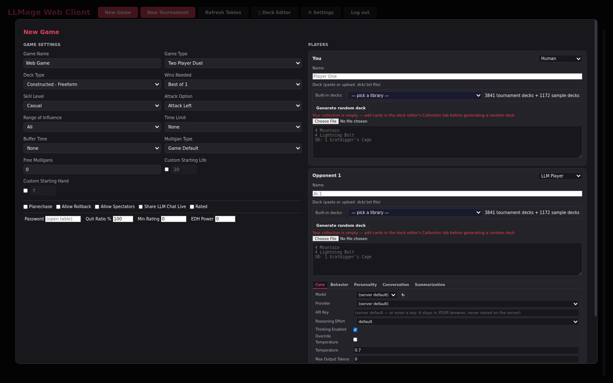
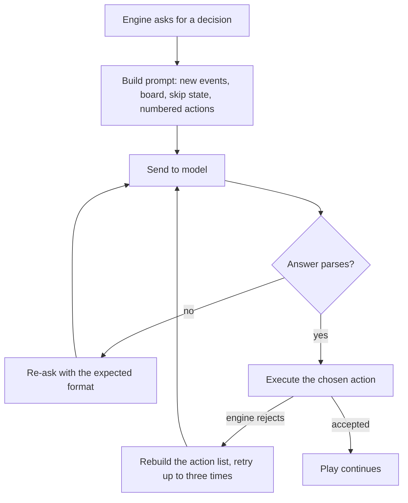

# LLM opponents

An LLM seat hands one player's decisions to a language model. The model receives a text picture of the game, chooses from the actions the rules engine offers, and replies in the exact format the engine expects. This page covers adding a seat, choosing its model and personality, how a decision is reached, what happens when the provider fails, and tournament behaviour. Endpoint and key setup belong to the operator: see [LLM providers](../operator-guide/llm-providers.md).

> **Who this is for:** Players who add, configure, or play against LLM-controlled seats.

> **LLMage addition.** Upstream XMage has no LLM player. The seat type, its configuration dialogs, and everything described here exist only on a server that runs the LLM player plugin.

## What an LLM seat is

An LLM seat is a player like any other: it has a name, a deck, a seat at the table, and a life total. What differs is where its answers come from. A normal computer opponent follows a heuristic script. An LLM seat sends each decision to a model behind an OpenAI-compatible chat endpoint and executes the answer it gets back.

The engine keeps authority over the rules. It decides which actions are legal, builds the menu the seat may choose from, and rejects anything that does not parse. The model never moves a card on its own; it selects among options the engine already approved.

Almost every decision class reaches the model: mulligans, priority and mana plans, targets, modes, piles, amounts, trigger order, attackers and blockers, card selection, and sideboarding.

Two situations deliberately skip the model call. A priority window whose only option is a single land play is played automatically; there is nothing to choose. While a skip is active, the seat passes priority without asking the model until something changes on the stack or the turn moves on.

The seat reads text, not images. Card rules text appears in full the first time a card shows up in a prompt; later prompts show a short form with name, cost, types, and power/toughness. The system prompt carries the full decklist and sideboard.

## Adding an LLM seat

### Desktop client

1. Open **New Table** from the Tables menu.
2. Set an opponent's player type to **Computer - LLM**.
3. Select **LLM Config...** on that seat to change its model, provider, thinking, or personality. Leave the fields alone to inherit the server defaults.
4. Load a deck for the seat from a deck file.
5. Select **Create**.

Setting your own seat to **Computer - LLM** produces an all-AI table that you watch.

### Web client

1. Select **New Game** in the lobby.
2. In a seat row, choose **LLM Player** as the type. The row expands with an LLM configuration split into five tabs: Core, Behavior, Personality, Conversation, and Summarization.
3. Optional: type a **Name** for the seat. An empty name lets the server assign one.
4. Paste or import a deck for the seat.
5. Select **Start Game**.

The **LLM Player** entry appears only when the connected server advertises LLM support. A stock XMage server does not, so the option is absent.

### Chat command

In the game-room chat, the `\botgame` command creates a two-seat table, fills the seats, and leaves you as a spectator.

| Command | Result |
|---|---|
| `\botgame` | LLM seat against the built-in computer opponent |
| `\botgame Legacy` | Same, with Legacy as the deck type |
| `\botgame --llm2` | Two LLM seats against each other |
| `\botgame --llm2 --bo3` | Two LLM seats, best of three |
| `\botgame --llm2 <deck-one.dck> <deck-two.dck>` | Two LLM seats with named deck files |

Deck-file arguments are paths on the server machine; without one, a deck is generated.

## Names and personalities

A seat that joins without a name gets one built from its model and a personality name, for example `deepseek-v4-flash-kestrel`. The model part is the model identifier cut at the first colon or slash. Names are deduplicated within a game.

A name you typed on the seat is kept. **Bot Name** in the seat configuration replaces it with a specific personality name from the registry.

Personality is a prompt section, not a separate model. Each registered name carries a character sketch and a playstyle note, appended to the system prompt when **Personality Enabled** is on and the seat's name resolves to a registered entry. The section restates that the goal is still to win. A name outside the registry adds nothing.

**Personality** in the seat dialog pins which character is used, independent of the seat's name. Leave it at auto-detect to follow the name.

## Choosing a model for a seat

Each seat can run a different model, endpoint, and key. Server defaults come from the operator's server configuration; any value you set on the seat wins over it, and an empty text field keeps the default. The **Core** tab holds the connection settings:

| Field | What it does |
|---|---|
| Model | Model identifier. The refresh button next to the field asks the endpoint for its model list. Empty keeps the server default. |
| Provider | Endpoint URL, chosen from the server's allowed providers or typed as a custom URL. Empty keeps the server default. |
| API Key | Key for this seat. In the web client a typed key stays in your browser and is never stored on the server. Empty uses the server's key for the default endpoint. |
| Reasoning Effort | Thinking level for this seat: default, low, medium, high, or max. `default` keeps the server's level. |
| Thinking Enabled | Sends thinking parameters with each request. Turn it off for a provider that rejects them. |
| Temperature | Off means the request omits the field and the provider applies its own default. |
| Max Output Tokens | Upper bound on one reply, reasoning plus answer. Zero applies no explicit total cap. |
| Timeout | Seconds to wait for one reply. Long games on large models need generous values. |

Two seat rules matter before you type an endpoint. Changing a seat's provider drops the server's key for that seat, so supply the seat's own key unless the new endpoint needs none. On a shared server the proxy also checks the host against an allowlist of model providers; a custom URL outside that list is refused when the table is created.

A browser-held key also means the server cannot detect that seat's context window. The form fills the value from the model list when the provider reports one.

## Thinking and effort

Thinking models spend part of their output budget on reasoning. The operator sets thinking defaults; a seat can override them.

| Control | Effect |
|---|---|
| Thinking dialect | How the request asks for reasoning: a reasoning-effort level, or an explicit token budget. A provider that speaks one dialect and receives the other rejects the request. |
| Reasoning effort | Named level the model is asked to use. Lower levels answer faster and reason less. |
| Reasoning cap | Hard ceiling on reasoning tokens, so a reasoning loop cannot consume the whole reply. |
| Terse stop | Cuts the reply at the first line break on prompts that demand a strict answer, so trailing commentary never reaches the parser. |
| Startup probe | A one-word test request at table join that carries the configured thinking parameters. A provider that rejects them fails the seat at join instead of mid-game. |

The web seat dialog warns next to **Thinking Enabled** when the provider is likely to reject thinking parameters; if it does, clear that checkbox for the seat.

## How the opponent decides

Each priority prompt contains four parts: the events since the seat's last decision, the current board, whether a skip is active, and a numbered list of legal actions. Action `0` always passes priority. Skip controls sit after the numbered actions, and a concede option follows them when the seat is allowed to concede. The reply is a bare number, optionally with a mana plan naming the lands to tap.

## Pre-game planning and sideboarding

Before the first decision, the seat reads its decklist and writes a game plan: archetype, win condition, keepable hands, key synergies, early sequencing. The plan joins the system prompt for the rest of the game. The call waits for the mulligan phase so the table opens while the model reads.

When a deck has a sideboard and the match has another game, the seat reviews the finished game, proposes swaps, and writes a revised plan for the new configuration. With no sideboard, or in a single game, it submits the deck unchanged.

## Retries and failures

A failed call is retried up to five times. Rate limits and server errors are retried with growing delays, and a provider's own retry hint wins over the built-in delay. Network drops and empty answers are retried as well. Other client errors, such as a wrong key or an unknown model, fail immediately; repeating a deterministic refusal only wastes time.

An empty answer usually means the model spent its whole budget thinking. The retries handle it in stages: a nudge asking for the bare answer, then a lower reasoning level on each attempt, and on the last attempt thinking is switched off so the answer gets the full output budget. A model that still returns nothing is treated as broken rather than silently passing priority.

If the provider cannot be reached at all, the seat concedes with a recorded reason. The game log shows `LLM provider failure` on the losing seat's line, the game ends normally, and in a two-seat game the winner's dialog reads **Victory (by forfeit)**.

A different failure is an action the engine rejects after the model picked it. The seat makes up to three attempts, and the final one carries the concrete rejection and an instruction not to repeat it. If the model still picks a rejected action, the seat passes priority and logs the stuck decision instead of ending the match.

## Long games and summarization

Conversation history grows with every decision. When it approaches a fraction of the model's context window, the seat compresses the older exchanges into a short narrative and keeps the most recent exchanges verbatim. The summary prompt asks for life totals, hand contents, and important permanents to survive exactly, since those facts drive the next decision.

The context window is detected when the seat joins: from the local model server's metadata, or from the provider's model list when the provider reports a context size. A provider that reports nothing needs an explicit value in the seat's Summarization tab or the server defaults. A seat without one fails at join rather than guessing.

The **Summarization** tab exposes the trigger fraction, the target size for the summary, and how many recent exchanges to keep. The defaults suit most models; lowering the trigger compresses earlier and keeps requests smaller.

## Tournaments

Tournament seats take the same configuration as table seats. Each seat in the tournament setup has its own LLM settings, so a bracket can mix models, providers, and personalities.

Two behaviours matter during play. Every round builds fresh seats with clean conversation history and a copy of the original deck, so sideboarding in one round does not leak into the next. A tournament with no human seats starts on its own once every seat has joined.

A best-of-three match produces a separate transcript for each game and seat, with post-game records written as each game ends.

## Limitations

- Latency is real. A thinking model can take a minute or more on a complex board, and the table waits.
- A provider that hides reasoning returns decisions without an explanation; asking for a one-line reason is the only way to see intent there.
- The seat cannot talk back. It does not read table chat or reply to it; its conversation view shows what it was thinking, not a dialogue.
- Model quality is the ceiling. A small model misreads card text, forgets its plan, and picks weak lines; the engine executes those picks faithfully.
- There is no fallback to the heuristic AI. A broken provider ends the game rather than handing the seat to a script.

## Related

- [LLM chat and logs](llm-chat-and-logs.md)
- [First LLM game](../getting-started/first-llm-game.md)
- [LLM providers](../operator-guide/llm-providers.md)
- [Game modes](game-modes.md)
