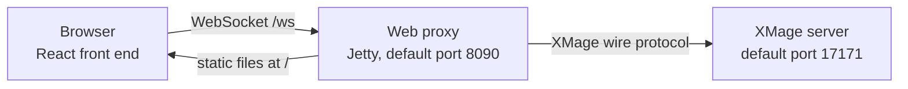
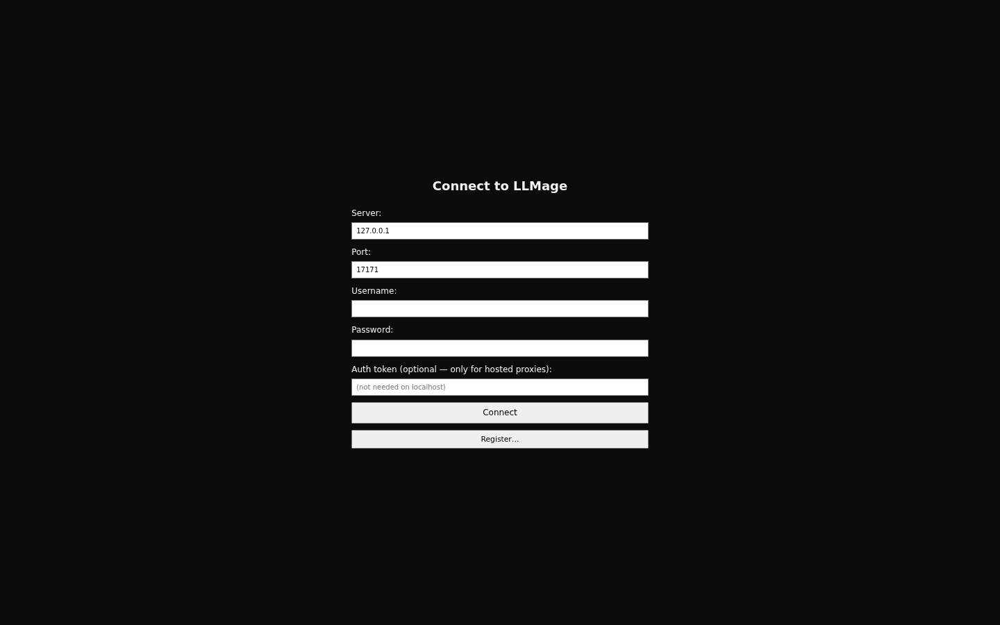
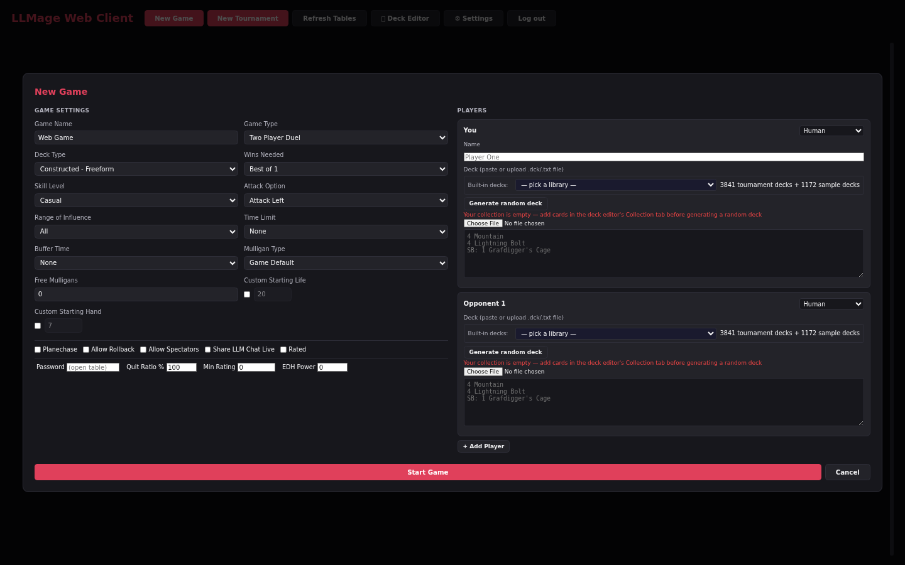
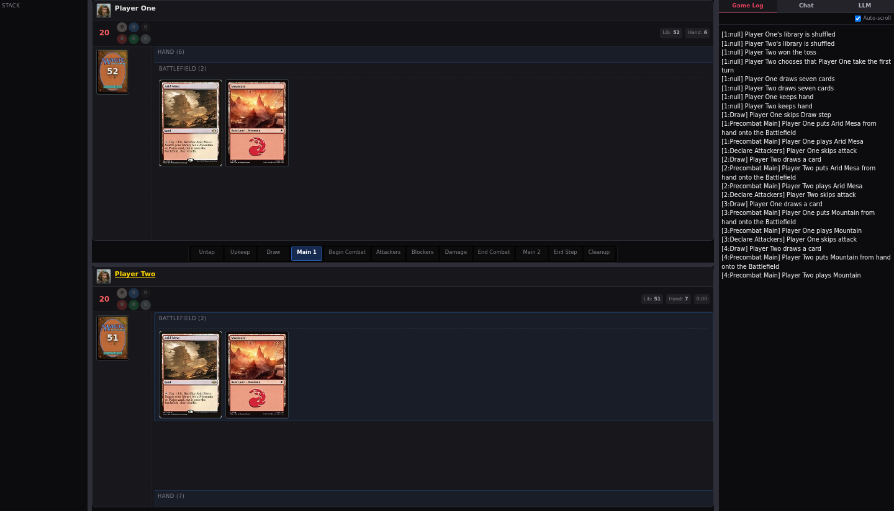
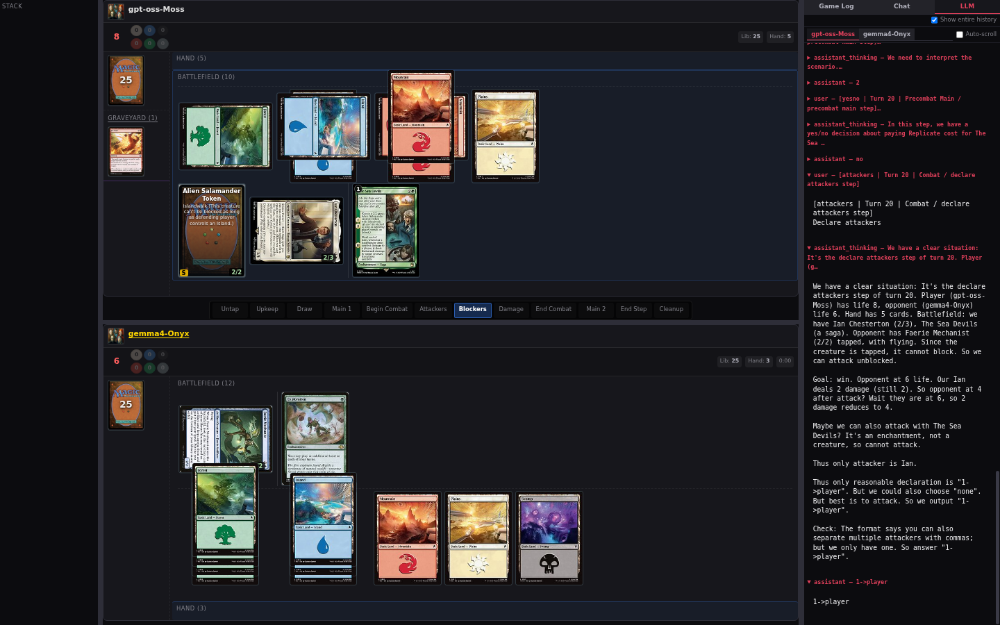

# The web client

LLMage includes a browser client: a small Java service called the web proxy plus a React front end. The proxy holds the XMage connection and the browser renders the lobby, table setup, the game board, the deck editor, and the replay viewer. You do not install the desktop client to play.

> **Who this is for:** Players who want to play LLMage in a browser and need to know what each screen offers.

## What runs where



| Piece | Role | Default |
|---|---|---|
| Browser front end | Lobby, table dialogs, board, deck editor, replay viewer | `http://localhost:8090/` |
| Web proxy | One XMage session per tab; serves the front end and bridges `/ws` | `127.0.0.1:8090` |
| XMage server | Lobby, games, saved replays, card database | `17171` |

The browser sends every request over one WebSocket; the proxy translates it into session calls.

## Start the proxy

The proxy needs the XMage server, a built proxy jar, and a built front end. Start the server first, then run:

```bash
cd <path-to-xmage>
scripts/start-proxy.sh
```

Open `http://localhost:8090/`. The proxy binds loopback only by default.

| Option | Default | Meaning |
|---|---|---|
| `--port <port>` | `8090` | Port the proxy listens on |
| `--bind <address>` | `127.0.0.1` | Interface to bind; a non-loopback address also needs an origin allowlist entry |

```bash
scripts/start-proxy.sh --port 8090
scripts/start-proxy.sh --bind 0.0.0.0
```

A LAN or VPN deployment also needs an origin allowlist entry; the operator guide covers it.

## The connect form



| Field | Notes |
|---|---|
| Server | Hostname or IP of the XMage server. Defaults to `127.0.0.1`. |
| Port | XMage server port. Defaults to `17171`. |
| Username | Required. Leading and trailing spaces are ignored. |
| Password | Sent once for this connection and never stored. |
| Auth token (optional — only for hosted proxies) | Shared secret for a proxy that requires one. Blank on loopback. |

The proxy has no field of its own: the address you loaded the page from is the proxy.

Use `127.0.0.1`, not `localhost`. On a dual-stack machine `localhost` resolves to the IPv6 loopback first while the XMage server listens on IPv4, and the handshake fails as if the server were offline.

The button shows **Connecting...** while the session is being established; failures print above it.

The username is kept in the tab's session storage, so a reload refills it and reconnects automatically (**Reconnecting to XMage**). The password and auth token are never stored.

**Register…** opens a dialog with server, port, user name, password, confirmation, and email; the passwords must match, and the email receives the generated initial password and password resets.

## Hosted deployments with a hidden server target

An operator can pin every browser session to one XMage server with `-Dwebproxy.pinnedXmageTarget=<server-host>:<port>`. The browser's server and port are then ignored. Adding `-Dwebproxy.hideServerTarget=true` also removes the fields from the form:

- The proxy answers `GET /config` with `{"hideServerTarget":true,"llmage":…}`.
- The form renders only **Username**, **Password**, and **Auth token**.
- The connect message carries no target at all.

Hiding the fields only works with a pinned target. A proxy started with the toggle on and no pin refuses to boot, because the browser would have no way to name a target. `scripts/start-proxy.sh` reads them from `XMAGE_PROXY_PINNED_TARGET` and `XMAGE_PROXY_HIDE_SERVER_TARGET`.

The form reads `/config` before it becomes interactive; if that request fails, it says so instead of guessing whether the fields belong on screen.

## The lobby


The header carries the client name and six actions: **New Game**, **New Tournament**, **Refresh Tables**, **🛠 Deck Editor**, **⚙ Settings**, and **Log out**. Logging out while seated asks for confirmation.

The main column is a dense grid with one row per open or running table:

| Column | Contents |
|---|---|
| Deck Type | Format the table expects |
| Name | Table name, or `Untitled` |
| Seats | Occupied and total seats |
| Owner | Player who created the table |
| Game Type | Duel, free-for-all, Commander, or another variant |
| Status | Waiting, dueling, or finished |
| Password | `YES` for a protected table |
| Created | How long the table has existed |

A segmented control filters **All**, **Matches**, and **Tournaments**, with **Rated only** and **Hide passworded** checkboxes. The action column offers **Join**, **Watch**, **Enter**, or **Start Match**. **Start Match** appears only for the table's owner and only once every seat is filled.

After joining, a waiting panel replaces the grid: *Joined table — waiting for match to start...* It offers **Start Match**, **Refresh Tables**, and **Leave**.

Below the grid, one list merges live tables, finished matches, and saved replay files. Rows carry a **LIVE** or **REPLAY** badge, players and decks, game type, result or status, duration, start time, and an action: **Spectate** or **Watch Replay**.

The right rail holds **Users (N)** — flag, name, ping, with your own row tagged `you` and sorted first — and a chat panel with **Talk** and **System** tabs. The **Message of the Day** strip sits along the bottom when the server defines one.

If the WebSocket drops, a red banner appears above the lobby: *Connection to the server was lost. Your last clicks were NOT sent — lobby actions are disabled.* Server actions are disabled until the connection returns. **Deck Editor** and **Settings** still open.

## Create a table



**New Game** opens a two-pane dialog. The left pane holds **Game Settings**:

| Field | Values |
|---|---|
| Game Name | Free text |
| Game Type | Duel, free-for-all, Commander, Oathbreaker, Brawl, Tiny Leaders, Canadian Highlander, Momir Basic, Penny Dreadful, and freeform variants |
| Deck Type | Constructed formats, variant formats, and Limited |
| Wins Needed | Best of 1, Best of 3, Best of 5 |
| Skill Level | Beginner, Casual, Serious |
| Attack Option | Attack Multiple Players, Attack Left, Attack Right |
| Range of Influence | 1, 2, All |
| Time Limit / Buffer Time | None or 5–120 minutes / None or 1–30 seconds |
| Mulligan Type | Game Default, Vancouver, Paris, London, Smoothed London, Canadian Highlander |
| Free Mulligans | 0 to 5 |
| Custom Starting Life / Hand | Checkbox plus a value, for each |

Four checkboxes follow: **Planechase**, **Allow Rollback**, **Allow Spectators**, and **Rated**. On an LLMage build connected to an LLMage server, a fifth appears: **Share LLM Chat Live**, which lets opponents and spectators read LLM chat during play. Replays always include it. A matchmaking row adds **Password**, **Quit Ratio %**, **Min Rating**, and **EDH Power**.

The right pane holds the seats. Each row shows **You** or **Opponent N**, a seat type, an optional name, and a deck field:

| Seat type | Behaviour |
|---|---|
| Human | Another person joins the seat after the table exists |
| AI (Mad) | The stock XMage computer opponent |
| AI (Monte Carlo) | The stock XMage simulation opponent |
| LLM Player | An LLM seat, offered only when the build and the connected server support it |


An LLM seat expands into five tabs, as on the desktop client: **Core**, **Behavior**, **Personality**, **Conversation**, and **Summarization**. An empty field means the server default or an automatic choice. The deck field accepts pasted text, an uploaded `.dck`, `.txt`, or `.dec` file, a saved deck, a built-in deck, or a random deck.

**+ Add Player** adds a seat; the minimum is two. **Start Game** creates the table and seats you; **Cancel** closes without sending anything. Joining someone else's table uses the same dialog in **Join Table** mode, which shows only the deck field, **Join**, and **Cancel**.

## During a game



The board mirrors the desktop layout: opponents above, your board and hand below, the phase strip in the centre, and a right rail for logs and chat. The header shows turn, step, phase, and priority, with **💡 Hints**, **⚙ Settings**, **Undo** when an undo bookmark exists, and **Concede**.

Questions appear in a draggable window over the board rather than in the rail, kept clear of the cards you need to click. Prompts cover yes/no questions, choice lists, targets, card-name choices, abilities, amounts, mana payment, piles, and multi-entry amounts. Mana payment opens at the bottom-right corner.

The rail keeps the controls that are not part of the question, including **Pass Priority**, six skip buttons (**Skip EOT**, **Skip Main**, **Skip Turn**, **Skip to My Turn**, **Skip Stack**, **Skip End Step**), **Cancel All Skips**, **Hold Priority**, **Rollback Turn**, and **Concede**. A skip button stays lit while the engine has that skip armed. See [Game controls](game-controls.md) for priority, combat, and targeting across both clients.

## The LLM tab


The rail has up to three tabs: **Game Log**, **Chat**, and **LLM**. The **LLM** tab appears only when the build, the connected server, and the current game all qualify — an LLMage bundle, an LLMage server, and at least one LLM seat. It shows one sub-tab per LLM player, with the conversation, reasoning, and streaming output as they arrive. If the table does not share LLM chat, the panel says no exchanges are visible to you.



Per-seat configuration lives in the table dialog, not in the rail. [LLM opponents](llm-opponents.md) explains models, personalities, and thinking modes.

## Spectating

**Watch** on a table row, or **Spectate** in the games list, opens the game as an observer. The header prefixes the title with an eye icon and replaces **Concede** with **Stop Watching**; Hints and prompts are not offered, because a spectator cannot act. The rail still shows the log and chat, plus the LLM tab when the game has an LLM seat.

## Settings

**⚙ Settings** is available from the lobby, the game header, and the replay header. It has seven tabs:

| Tab | Contents |
|---|---|
| Display | Font size, UI scale, card size, auto-fit, hover preview, multiplayer layout |
| Appearance | Avatar, theme, highlight colours |
| Alerts | Priority sound, screen flash, prompt memory, event sounds |
| Tokens | Global token-art override |
| LLM Chat | Whole-history mode in the replay viewer |
| Presets | Named snapshots of every setting in the dialog |
| Hotkeys | Rebindable game shortcuts; replay keys are fixed |

Settings live in the browser, not on the server. [Keyboard shortcuts](../reference/keyboard-shortcuts.md) lists the defaults.

## Deck editor and replays

**🛠 Deck Editor** opens a full-screen editor with search, deck and sideboard, legality, and a collection tab. [Web deck editor](web-deck-editor.md) covers it.

**Watch Replay** on a finished game or a saved file opens the read-only viewer, with step controls, a scrubber, and the per-seat LLM conversation. [Web replay viewer](web-replay.md) covers it.

## Stock servers and the LLMage build

Two separate gates decide what the browser shows. The first is the build:

| Build | Front end | Proxy jar | LLM features |
|---|---|---|---|
| LLMage | `npm run build` | `-Pllmage` | Present |
| Minimal | `npm run build` | plain `mvn` | No relay route; the browser-key bridge is unavailable |
| Stock | `VITE_LLMAGE=false npm run build` | `-Pstock` | Compiled out; branding reads **Connect to XMage** |

The second gate is the server. After the handshake the proxy reads the server's own advertised player types and version, then sends a capability object with the `connected` message:

| Capability | True when | Effect |
|---|---|---|
| `llm` | The server advertises an LLM player type | LLM seat, per-seat LLM config, **Share LLM Chat Live**, and the rail's LLM tab are offered |
| `replayScrubber` | Same signal as `llm` | The server accepts a seek to an arbitrary saved frame |
| `replaySidecar` | Same signal as `llm` | Saved files carry searchable metadata: players, decks, winner, timestamps |
| `serverVersion` | The version parses | Reported for diagnostics; never used to guess capabilities |

The scrubber and sidecar follow the LLM signal: an official server has no seek call and its version string is identical to LLMage's.

Against a stock server the LLM seat option, its configuration block, the rail's LLM tab, and the chat-sharing checkbox all disappear, and the proxy refuses LLM requests outright. A stock **bundle** ships no LLM code at all, even when the server supports it.

`GET /config` reports whether the connect form may show a server target and whether the proxy jar is an LLMage build.

## Related

- [Web deck editor](web-deck-editor.md)
- [Web replay viewer](web-replay.md)
- [Game controls](game-controls.md)
- [LLM opponents](llm-opponents.md)
- [Deployment](../operator-guide/deployment.md)
