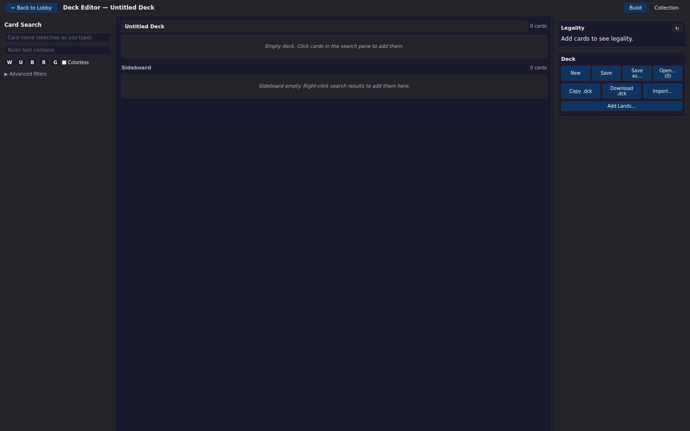

# The web deck editor

The browser client includes a full deck editor. It searches the server's card database, builds a main deck and sideboard, checks legality against sixteen formats, imports and exports `.dck` files, and keeps your decks and collection in the browser.

> **Who this is for:** Players who build or edit a deck in the web client before creating or joining a table.

## Open the editor

Select **🛠 Deck Editor** in the lobby header. The editor replaces the lobby view; there is no separate URL. Decks live in local storage; card data comes from the server through the proxy. The editor opens even while the game server connection is down — only searches, printings, and legality checks need the connection.

The header has **← Back to Lobby**, the title **Deck Editor — <name>** with an asterisk when the deck has unsaved changes, and two tabs: **Build** and **Collection**.

## Layout

The editor is a three-column layout:

| Column | Contents |
|---|---|
| Left | Card search and filters |
| Centre | The working deck and, below it, the sideboard |
| Right | Legality badges and the deck file controls |

Both outer columns have drag handles. The left column runs from 240 to 800 pixels, the right from 280 to 800, and both widths are remembered in the browser.

## Search for cards

The search panel has two text fields and a row of colour filters:

| Control | Behaviour |
|---|---|
| Card name (searches as you type) | Substring match on the card name |
| Rules text contains | Substring match on rules text |
| W, U, B, R, G | Toggle one or more colours |
| Colorless | Include colourless cards |

There is no Search button. Typing starts a request after a short pause, and a newer keystroke cancels the older request so a stale result cannot overwrite a fresh one.

**Advanced filters** adds:

| Filter | Values |
|---|---|
| Types | Creature, Instant, Sorcery, Enchantment, Artifact, Land, Planeswalker, Tribal, Battles |
| Rarities | Common, Uncommon, Rare, Mythic, Special, Bonus |
| Set codes | Comma-separated codes, for example `MH3, OTJ, BLB` |
| Mana value | Exact number |
| Sort | Default (set order), Name, Rarity, Color, Mana value |

Results appear as a card-image grid with a count line such as `132 cards`. A single request returns at most 200 printings, so narrow the filters when a name has many reprints. Each tile shows the set code and collector number, the primary card type, the rarity, and up to three badges: **Deck ×N**, **SB ×N**, and **Col ×N** for copies already in the main deck, the sideboard, and your collection.

## Add and change cards

| Action | Result |
|---|---|
| Click a search result | Adds one copy to the main deck |
| Right-click a search result | Adds one copy to the sideboard |
| **+Col** on a search result | Adds one copy to your collection |

Right-click a card in the deck or sideboard grid to open its menu:

| Menu item | Result |
|---|---|
| **🎨 Change art…** | Lists every printing of that card so you can pick another one |
| **+1 Copy** | Adds one copy |
| **−1 Copy** | Removes one copy; disabled at one |
| **→ Sideboard** | Moves the entry to the sideboard |
| **→ Main deck** | Moves a sideboard entry back |
| **Remove all copies** | Deletes the entry |

Changing the art keeps the card's count and zone and swaps only the set code and collector number. Printings load from the server when the dialog opens, so the list reflects the card database the connected server actually has.

The deck panel's name is an editable field. The count beside it is the total number of main-deck cards, not the number of distinct entries. An empty deck shows *Empty deck. Click cards in the search pane to add them.*

## Sideboard

The sideboard sits under the main deck with its own card grid and count. It is empty until you right-click a search result or move a main-deck entry across. Sideboard entries keep their own printings, so a different art chosen for the main-deck copy does not carry over to the sideboard copy.

## Legality

The right column carries a **Legality** panel with a refresh button. Every edit schedules a check after a short pause, and the panel sends the whole deck to the proxy, which runs the server's own deck validators.

The panel renders one badge per format: Standard, Pioneer, Modern, Legacy, Vintage, Pauper, Historic, Commander, Oathbreaker, Brawl, Frontier, Historical Type 2, Penny Dreadful Commander, European Highlander, Canadian Highlander, and Freeform. A badge is coloured for legal, partly legal, illegal, or unknown; hover it to read the grouped errors.

Two extra readouts appear when the deck supports them:

- **EDH Power Level** — a level and the number of power cards found.
- **Commander Brackets** — one badge per bracket from B1 to B5, with the offending cards in the tooltip.

While a check is running for a deck that already has a result, the panel says *Checking this deck… badges below are from the previous version* rather than presenting stale badges as current. An empty deck shows *Add cards to see legality.*

## Import and export

The deck controls offer three file operations:

| Button | Result |
|---|---|
| **Copy .dck** | Copies the deck as text to the clipboard |
| **Download .dck** | Downloads `<deck name>.dck`; characters outside letters, digits, `_`, and `-` become underscores |
| **Import…** | Opens a paste box and a file picker accepting `.dck`, `.txt`, and `.dec` |

The import parser accepts several line shapes:

| Line | Meaning |
|---|---|
| `NAME:My Deck` | Sets the deck name |
| `4 Lightning Bolt` | Four copies by name |
| `4 [SET:123] Lightning Bolt` | Four copies with an explicit printing |
| `SB: 2 Duress` | Two sideboard copies |
| `4 x Lightning Bolt (mh3) 123 [Instant]` | Annotated export in the style produced by deck sites |

Lines starting with `#` or `//` are ignored, as are `AUTHOR:` and `LAYOUT` headers. The parser rejects a malformed line with its line number, rejects an annotated line whose leading count contradicts its trailing `xN` echo, and rejects a line that looks like an annotated export but is missing its printing or type. A rejected import changes nothing; the error names the problem so you can fix the text.

Importing replaces the current main deck and sideboard and clears the saved-deck link. Save the result if you want to keep it.

## Save, open, and the working draft

Decks are stored in this browser, not on the server. A deck saved in one browser is not visible in another, and clearing site data removes it.

| Button | Result |
|---|---|
| **New** | Starts an empty deck named `Untitled Deck` |
| **Save** | Writes the current deck over its saved copy; disabled when the deck is unchanged and already saved |
| **Save as…** | Saves under a new name |
| **Open… (N)** | Lists saved decks with their last-saved date; click a name to load it, or **✕** to delete it |

Separately from saved decks, the editor keeps the deck you are working on as a draft. Every edit writes the draft, so closing the tab and returning to the editor restores the deck exactly as you left it, including unsaved changes.

## Add lands

**Add Lands…** opens a small dialog with a stepper for Plains, Island, Swamp, Mountain, Forest, and Wastes. Set the counts, check the total, and select **Add lands**. The dialog does not choose a printing; it asks the server's card database for each basic land by name at add time, so the deck never carries a printing the server does not have. If a land cannot be resolved, the dialog stays open with the error and the counts intact.

## The Collection tab

**Collection** switches the centre column from the deck to the cards you own. The tab is a browsing and bookkeeping surface, not a second deck:

| Control | Result |
|---|---|
| **→ Deck** | Adds the card to the main deck |
| **+1** | Adds one owned copy |
| **−1** | Removes one owned copy |
| **Clear all** | Empties the collection immediately |

Cards are grouped by set with an owned count per card and a `N unique cards` total. The collection is filled from **+Col** on search results. If an owned printing is not in the connected server's card database, the panel names it under *Not on this server* instead of hiding it.

## Limits worth knowing

- The editor does not draw a mana curve or any statistics panel. Legality badges and the two card counts are the only aggregate readouts.
- Search returns at most 200 printings per request.
- Legality is computed by the server, so it needs a live connection and reflects that server's ban lists and card database.
- Decks and the collection are browser-local; there is no server-side deck library.

Base XMage behaviour is documented in the [upstream XMage wiki](https://github.com/magefree/mage/wiki).

## Related

- [The web client](web-client.md)
- [Web replay viewer](web-replay.md)
- [Game controls](game-controls.md)
- [LLM opponents](llm-opponents.md)
