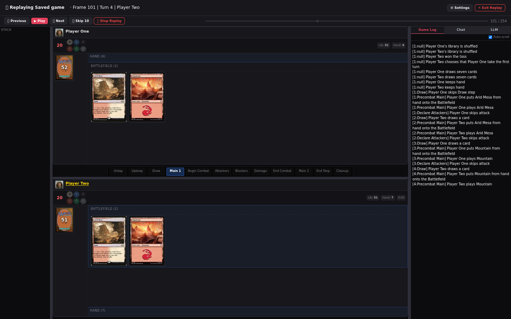
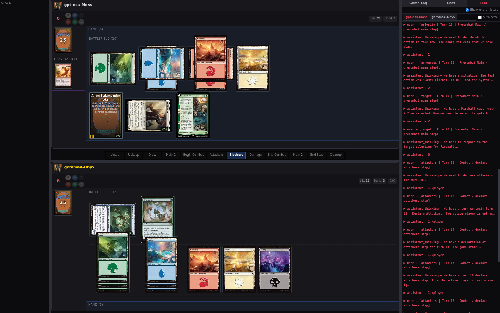

# The web replay viewer

The browser client can replay a finished game. The viewer loads the saved game from the server, steps through it frame by frame, and lets you scrub to any saved position. It is read-only: no click on the replay board sends a game action.

> **Who this is for:** Players who want to review a completed game in the browser, including the LLM conversation behind each decision.

## Find a replay

Replays start from the games list below the lobby's table grid. Two kinds of row carry a **REPLAY** badge:

| Row source | What it is |
|---|---|
| Finished match | A game the server has finished and still lists, with its table name, players, decks, and result |
| Saved file | A `<game-id>.game` file in the server's replay directory, with whatever metadata the server recorded |

A finished match and its saved file describe the same game. The list shows one row for it and prefers the finished-match row, because that row carries richer metadata. A saved file with no matching lobby record still appears on its own — for example after a server restart.

Rows show the date, the players with their decks and match wins, the game or table name, the score, and the duration. Files saved before the server wrote metadata sidecars are marked `legacy`; they show the game id and file date and nothing else. The list is read when the lobby connects, so reconnect or reload the page to pick up a game saved since then.

## Load a replay

Select **Watch Replay** on a row. The row shows a loading note while the proxy acknowledges the request, and the viewer opens with a load screen naming the save's size, because the server deserializes the whole file before it can send the first frame:

> 18.4 MB save — the server is deserializing it. This takes a few seconds for a large game.

The viewer opens as soon as the server creates the replay session and starts playback automatically. Until the first frame arrives, the header reads **🎬 Loading replay <game-id>…** and the board area explains that the server is deserializing the save.

A load can be refused. While a game is running, the proxy rejects the request and the viewer never opens; a missing or corrupt file surfaces as an error and the viewer closes.

## Playback controls

The playback bar sits under the header:

| Control | Action |
|---|---|
| **⏮ Previous** | Step back one saved state |
| **▶ Play** / **⏸ Pause** | Start or stop automatic playback |
| **⏭ Next** | Step forward one saved state |
| **⏩ Skip 10** | Jump forward ten plays |
| **⏹ Stop Replay** | Close the replay and return to the lobby |
| Position slider | Jump to any saved state |

Automatic playback advances one frame per second. Stepping is driven by the server, not by a local cursor: each step asks the proxy for the neighbouring saved state and the board redraws when it arrives, so a slow frame cannot desynchronise the viewer from the game.

The header also carries **⚙ Settings**, which opens the same settings dialog as a live game, and **✕ Exit Replay**, which does what **Stop Replay** does.

## Keyboard

| Key | Action |
|---|---|
| `Space` | Play or pause |
| `→` | Next frame |
| `←` | Previous frame |
| `Esc` | Exit the replay |

These keys belong to the viewer only while nothing else needs them. Typing in the chat box keeps the keystrokes in the field. While the settings dialog is open, `Esc` closes the dialog instead of the replay. While a card context menu is open, `Esc` closes the menu and the viewer ignores that press. [Keyboard shortcuts](../reference/keyboard-shortcuts.md) lists the full set of defaults for both clients.

## The position slider

The slider spans the saved game's state list. The server numbers states from zero; the label shows them from one, as `37 / 412`. Dragging or clicking the track seeks directly to that state instead of stepping through everything in between.

Two cases degrade gracefully:

- Before the first frame arrives, the slider is disabled.
- If the connected proxy does not report a frame count, the slider renders a single-frame track and the label shows the running frame counter instead of a position out of a total.

Stepping off either end stops playback and prints a boundary notice instead of closing the session: *End of replay — step back to continue* or *Start of replay — step forward to continue*. The replay stays loaded, so you can step back into it.

## What you can inspect

The replay uses the same board layout as a live game: in a duel one seat sits above and one below, with the phase strip, the right rail, and the revealed-cards buttons. Rail and divider widths are draggable and persist, because resizing a replay is a viewer preference.

Read-only means:

- Card previews, zone popups for graveyards, exile, and sideboards, and the revealed-cards popup all work.
- The card context menu offers only preview and copy actions; there are no play, cast, or activate entries.
- No prompt window appears, and no board click sends an action.
- The header has no Hints button and no Concede.

The right rail offers up to three tabs:

| Tab | Contents |
|---|---|
| **Game Log** | The saved game log as it stood at the current frame |
| **Chat** | The game's chat transcript |
| **LLM** | The LLM conversation for the current frame or up to it |

The **Game Log** tab is offered only when the save carries log data. A save written before log capture has no log, and the tab is hidden rather than shown empty.

## The LLM conversation

The **LLM** tab exists when the bundle, the connected server, and the replayed game all qualify: an LLMage build, an LLMage server, and at least one LLM seat. It shows one sub-tab per LLM player, with the same conversation view as a live game: system prompt, exchanges, reasoning, and the per-frame counters.

Each replay frame carries only the exchanges recorded at that exact saved state. That is often one decision point, so many frames — especially an opponent's turn — would show nothing. A checkbox in the panel, **Show entire history**, switches the tab to accumulate every exchange at or before the current frame. The same switch lives in **⚙ Settings** under **LLM Chat** as **Show entire history in replays**, and the two stay in sync.

With history off, the panel reports *No LLM exchanges recorded at this frame.* With history on and nothing yet recorded, it reports *No LLM exchanges recorded up to this frame.*

The cumulative view is rebuilt while you scrub: stepping backward drops later exchanges, stepping forward adds them, and the panel never shows a decision that had not happened yet at the displayed frame.

## Limits

| Limit | Effect |
|---|---|
| Stock server | No seeking: the proxy rejects a seek request with an error, and stepping still works |
| Old save | No log tab, and only the game id and file date in the list |
| Old proxy | No frame count, so the slider shows a single-frame track |
| Live game | A replay cannot be loaded while a game is running |
| Read-only | Nothing on the replay board changes the saved game |

Base XMage behaviour is documented in the [upstream XMage wiki](https://github.com/magefree/mage/wiki).

## Related

- [The web client](web-client.md)
- [Web deck editor](web-deck-editor.md)
- [LLM opponents](llm-opponents.md)
- [Game controls](game-controls.md)
